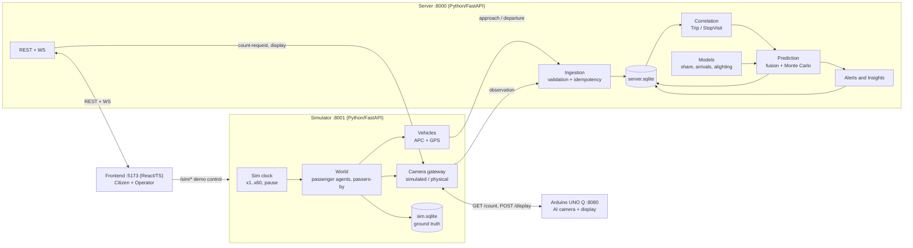
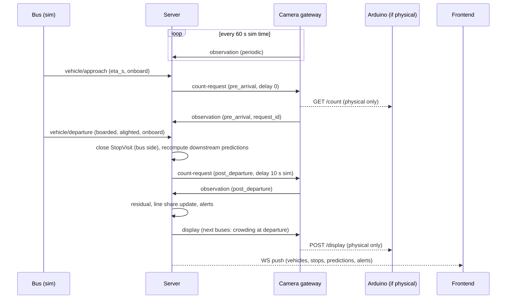
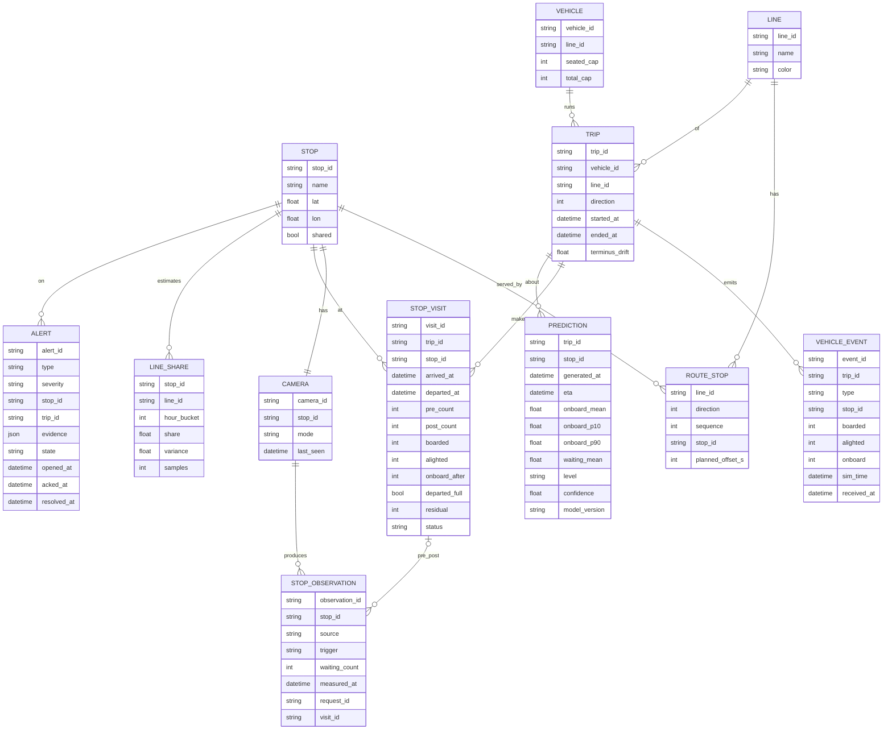
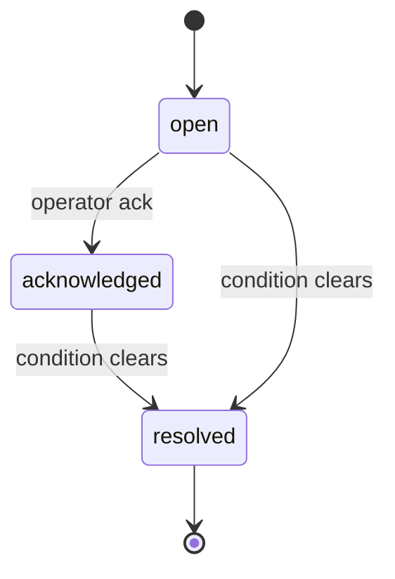

# Bus Crowding Monitor - Predictive Crowding System for Public Transport

A prototype that combines on-board passenger counting (APC + GPS) with smart bus-stop cameras to predict crowding at stops and on buses, with a calibrated confidence that updates in real time. It serves two interfaces: a citizen web app and an operator dashboard. Physical stop displays receive the same predictions.

**Delivery target:** October 11, 2026, 16:00 Europe/Rome.
**Runtime:** localhost for the demo.
**Stack:** Python/FastAPI (server and simulator), React/TypeScript (frontend), SQLite via SQLAlchemy, Arduino UNO Q (physical smart stop).

This document is the single source of truth for the project: vision, architecture, message contracts, data model, prediction logic and roadmap.

---

## 1. Vision and business value

The system moves public transport from passive measurement to predictive management. It does not only count people: it forecasts crowding, adjusts expectations as live data arrives, and detects anomalies.

- **Operator (B2B):** a business intelligence tool to optimize the fleet, find service flaws, and quantify lost demand and revenue.
- **Citizen (B2C):** a reliability index for each journey that tells the passenger in advance how crowded the stop and the bus will be.

### The given (APC) vs. the novelty (smart stops)

- **APC measures the supply.** Automatic Passenger Counting is the industry standard. It tracks boardings and alightings, so the system knows how many people are on the bus. It is blind to what happens outside the doors.
- **Smart stops measure the demand.** A camera at each stop counts people waiting. This unlocks three capabilities:
  1. **Live prediction.** Downstream crowding is predicted from live demand, not only from historical averages.
  2. **The APC blind spot.** If 30 people wait and a full bus takes 5, the APC records "+5". The camera sees the 25 left behind: unserved demand and lost fares become measurable.
  3. **Proactive alerts.** A sudden crowd is detected before the next bus arrives, giving the operator time to react.

### Hardware principles

- **Zero-touch fleet integration.** The server ingests the operator's existing APC and GPS/AVL streams. No changes to the buses.
- **Edge cameras.** Counting runs on the device at the stop. The production target is low-power hardware (TinyML-class microcontrollers, PIR wake-up, micro-power from street lighting). The prototype uses an Arduino UNO Q: its Linux MPU runs the counting model and a small HTTP server, and its MCU drives peripherals.
- **Privacy by design.** No frames or faces are stored or transmitted. The device converts images into a number and discards them.

### Return on investment

1. **Targeted fare-evasion enforcement:** compare APC counts with validated tickets to find evasion spikes by route and time.
2. **Fleet and route optimization:** cut empty runs and deploy high-capacity vehicles where data shows chronic bottlenecks.
3. **Unmet demand analysis:** quantify passengers left behind and the missed fares they represent.

### Future: GTFS-Realtime

The output APIs are designed to be mapped to the GTFS-Realtime occupancy fields, so that crowding predictions can be shown in Google Maps, Apple Maps and Moovit without a dedicated app.

---

## 2. Team and status

| Component | Owner | Status |
| --- | --- | --- |
| Central server: ingestion, correlation, models, prediction, alerts, output APIs | Backend workstream | Specified in this document |
| World simulator and camera gateway | Backend workstream | Specified in this document |
| Citizen web app and operator dashboard | Frontend workstream | In progress on the `frontend` branch with labelled mock data |
| Physical smart stop (Arduino UNO Q, camera, display) | Hardware colleague | Separate workstream; contract in this document |
| Shared documentation | Team | `README.md` on `main` |

## 3. Demo scope

- GTT lines **33** and **42** in Turin, which share a section of route and some stops. Each line is navigated independently, without transfers. More lines can be added via the GTFS import.
- A single **world simulator** generates buses, passengers and camera readings for every stop.
- One stop can be switched live from its simulated camera to the **physical camera**, and back.
- The simulated clock runs in real time and can be **accelerated or paused**.
- **5 weeks of synthetic history** (4 for training, 1 for testing) train the prediction models.
- Controllable scenarios: normal service, rush hour, overcrowding.
- Seated and total vehicle capacity are both considered.
- Everything runs on localhost. Sharing with other devices is deferred.

Real route geography is the target. Bus movements, passenger counts and history are simulated, and are labelled as such everywhere.

---

## 4. System architecture



### Component responsibilities

- **Simulator**
  - *Sim clock:* the single time source for the simulated world. Speed x1 to x60, pause and resume.
  - *World:* passenger agents, passers-by, scenarios. It owns the ground truth.
  - *Vehicles:* buses moving along the GTFS shapes. Each one has APC and GPS and sends `approach` and `departure` events to the server.
  - *Camera gateway:* one virtual camera per stop. It sends periodic and on-request observations, and receives display updates. For the physical stop it forwards requests to the Arduino.
- **Server**
  - *Ingestion:* validates payloads, deduplicates by ID, stores raw data.
  - *Correlation:* builds trips and stop visits, and pairs observations with visits.
  - *Models:* arrival rates, alighting fractions and per-line demand share, trained on history.
  - *Prediction:* fuses history with live data and propagates crowding along each trip with Monte Carlo sampling.
  - *Alerts and insights:* anomaly rules, alert lifecycle, operator analytics.
  - *API:* REST for queries and commands, WebSocket for live push to the frontend.
- **Frontend:** the citizen app and the operator dashboard, plus the demo control panel. No persistence.
- **Edge (Arduino UNO Q):** counts people on-device, answers `GET /count`, renders `POST /display`.

---

## 5. World simulator

The simulator is the only producer of synthetic data. Buses and cameras are *sensors* that observe the simulated world. The server never sees the world directly.

### Agent model

- **Passengers.** Each passenger has an origin stop, a desired line and direction, a destination stop and a patience.
  - Arrivals follow a Poisson process with rate `λ(stop, line, hour, scenario)`, multiplied by a daily noise factor (events, weather) so that the history is not perfectly regular.
  - When a bus of the desired line arrives, the passenger boards if there is room. Otherwise they keep waiting.
  - A passenger whose waiting time exceeds their patience leaves the stop. This is the ground truth for abandonment.
  - On board, the passenger alights at the destination.
- **Passers-by.** They walk through the camera's field of view for a few seconds without waiting. They add realistic noise to the counts.
- **Buses.**
  - They leave the terminus every *headway* minutes and follow the GTFS shape.
  - Dwell time depends on boardings and alightings.
  - Onboard starts at 0 at the first terminus and must return to 0 at the last one.

### Sensor models

- **APC:** true boardings and alightings with per-count error and a small cumulative drift. The drift is what the terminus reset exposes.
- **Camera:** the true number of people in frame (waiting passengers plus passers-by) with gaussian error and undercounting in large crowds (occlusion).

### Parameters (initial values, tunable)

| Parameter | Value |
| --- | --- |
| Bus capacity (12 m) | 28 seated, 95 total |
| Headway | 10 min per line and direction |
| Fleet per line | `ceil(round_trip_time / headway)` |
| Inter-stop travel time | 60-120 s |
| Dwell time | 15 s + 2 s per boarding + 1.5 s per alighting |
| Base arrival rate | 0.5 passengers/min per stop per line |
| Peaks | 07:30-09:00 and 17:00-19:00, ×3 on hubs and on the shared section |
| Overcrowding scenario | ×10 at one stop for 20 min |
| Patience | lognormal, median 15 min |
| Passers-by | 0.3/min, in frame for 5-20 s |
| Camera error | gaussian 8%, undercounting above 20 people |
| APC error | 2% per count, drift +0.3 people per stop |
| Camera periodic cadence | 60 s (simulated time) |
| Post-departure count delay | 10 s (simulated time) |

### Scenarios and ground truth

- Scenarios (`normal`, `rush_hour`, `overcrowding`) are YAML files that override rates and multipliers. They can be changed at runtime with `POST /sim/scenario`.
- Ground truth is stored in `sim.sqlite`: every passenger (origin, line, destination, outcome: boarded, left behind or abandoned) and the true counts per stop and per bus. It is exposed only via `GET /sim/truth` for the validation panel. The server never uses it for predictions.
- Batch mode runs the same simulator without real-time pacing to generate the synthetic history.

---

## 6. Stop visit sequence



1. **Periodic count:** each camera reports every 60 s of simulated time.
2. **Approach:** when a bus is about to reach a stop, it sends `vehicle/approach`. The server opens a stop visit and asks the camera for a fresh pre-arrival count.
3. **Departure:** when the doors close, the bus sends boarded, alighted and onboard. The server closes the bus side of the visit and recomputes predictions for downstream stops.
4. **Post-departure count:** 10 s later (simulated time), the camera reports how many people remain. Alighted passengers are assumed to have left the counted area.
5. **Outputs:** the server updates the residual demand, the line-share estimate and the alerts, then pushes a display update to the stop and live deltas to the frontend.

---

## 7. Message contracts: who sends what to whom

| Endpoint | From → To | Payload |
|---|---|---|
| `POST /ingest/vehicle/approach` | Sim → Server | event_id, vehicle_id, trip_id, line_id, direction, next_stop_id, stop_sequence, eta_s, lat, lon, onboard, sim_time |
| `POST /ingest/vehicle/departure` | Sim → Server | event_id, vehicle_id, trip_id, line_id, direction, stop_id, stop_sequence, arrived_at, doors_closed_at, boarded, alighted, onboard, lat, lon, is_terminus |
| `POST /ingest/camera/observation` | Gateway → Server | observation_id, camera_id, stop_id, source (simulated/physical), measured_at, waiting_count, trigger (periodic/pre_arrival/post_departure), request_id?, visit_id? |
| `POST /cameras/{id}/count-request` | Server → Gateway | request_id, visit_id, reason, delay_s. The gateway replies `202 Accepted`, then sends the observation |
| `POST /cameras/{id}/display` | Server → Gateway (→ Arduino) | stop_id, generated_at, buses[{line_id, eta_s, predicted_onboard, interval_80, level, confidence, may_not_fit}] |
| `GET /count`, `POST /display` | Gateway ↔ Arduino | `{count, measured_at}` / display payload |
| `GET /api/lines`, `GET /api/lines/{id}` | FE → Server | ordered stops per direction, shape, shared flag |
| `GET /api/vehicles`, `GET /api/stops/{id}` | FE → Server | observed state and predictions. Each value carries kind (observed/predicted/simulated), measured_at, confidence |
| `GET /api/journey?line&dir&from&to` | FE → Server | journey stops, next buses, predicted onboard crowding per segment, predicted waiting |
| `WS /ws/live` | Server → FE | deltas: vehicles, stops, predictions, alerts, clock |
| `GET /api/operator/alerts`, `POST /api/operator/alerts/{id}/ack` | Operator → Server | alert list and lifecycle |
| `GET /api/operator/history`, `/api/operator/insights`, `/api/operator/calibration` | Operator → Server | aggregates by stop, line and time bucket; system flaws; reliability chart |
| `POST /sim/clock`, `POST /sim/scenario`, `POST /sim/cameras/{id}/mode`, `GET /sim/truth` | Demo control → Sim | speed/pause, scenario, camera switch, ground truth for validation |

### Example payloads

IDs and timestamps below are illustrative. Real stop IDs come from the GTFS import.

`POST /ingest/vehicle/departure`

```json
{
  "event_id": "evt-42-0703-s12-dep",
  "vehicle_id": "bus-42-03",
  "trip_id": "42-0-20261011-0730",
  "line_id": "42",
  "direction": 0,
  "stop_id": "gtt-1234",
  "stop_sequence": 12,
  "arrived_at": "2026-10-11T07:51:10+02:00",
  "doors_closed_at": "2026-10-11T07:51:52+02:00",
  "boarded": 9,
  "alighted": 3,
  "onboard": 61,
  "lat": 45.0703,
  "lon": 7.6869,
  "is_terminus": false
}
```

`POST /ingest/camera/observation`

```json
{
  "observation_id": "obs-cam-1234-20261011T075202",
  "camera_id": "cam-1234",
  "stop_id": "gtt-1234",
  "source": "physical",
  "measured_at": "2026-10-11T07:52:02+02:00",
  "waiting_count": 7,
  "trigger": "post_departure",
  "request_id": "req-8f2c",
  "visit_id": "visit-42-0730-s12"
}
```

`POST /cameras/{id}/count-request`

```json
{
  "request_id": "req-8f2c",
  "visit_id": "visit-42-0730-s12",
  "reason": "post_departure",
  "delay_s": 10
}
```

`POST /cameras/{id}/display`

```json
{
  "stop_id": "gtt-1234",
  "generated_at": "2026-10-11T07:52:03+02:00",
  "buses": [
    {
      "line_id": "33",
      "eta_s": 240,
      "predicted_onboard": 71,
      "interval_80": [58, 84],
      "level": "yellow",
      "confidence": 0.68,
      "may_not_fit": false
    },
    {
      "line_id": "42",
      "eta_s": 540,
      "predicted_onboard": 92,
      "interval_80": [80, 95],
      "level": "orange",
      "confidence": 0.55,
      "may_not_fit": true
    }
  ]
}
```

`GET /api/journey` (one stop item)

```json
{
  "stop_id": "gtt-1240",
  "sequence": 15,
  "eta": { "value": "2026-10-11T08:01:30+02:00", "kind": "predicted" },
  "waiting": { "value": 14, "kind": "observed", "measured_at": "2026-10-11T07:59:00+02:00", "source": "simulated" },
  "onboard_at_departure": {
    "value": 78,
    "kind": "predicted",
    "interval_80": [64, 91],
    "level": "orange",
    "confidence": 0.61,
    "generated_at": "2026-10-11T07:59:15+02:00",
    "model_version": "v0.3"
  }
}
```

### Common rules

- **Time:** all timestamps are simulated time in ISO 8601 with offset. `received_at` is added by the server.
- **Idempotency:** `event_id` and `observation_id` are unique. Duplicates are ignored (`200`, no effect). Invalid payloads are rejected with `422`.
- **Freshness:** an observation older than 3 periods (180 s of simulated time) is stale. Stale or missing data is *unavailable*, never zero.
- **Provenance:** every value exposed to the frontend carries `kind` (observed/predicted/simulated) and its timestamp.
- **Contracts:** all payloads are Pydantic models in `shared/`. JSON Schema is exported from them and the TypeScript types are generated, so frontend and server cannot drift apart.
- **Security:** the endpoints have **no authentication**, which is acceptable only for the localhost demo. API keys for ingestion, the gateway and the Arduino, plus operator authentication and TLS, are required before any network exposure.

---

## 8. Data model



### Table groups (server.sqlite)

| Group | Tables | Rules |
| --- | --- | --- |
| Static | LINE, STOP, ROUTE_STOP, VEHICLE, CAMERA | Loaded from the GTFS fixture and the simulator config. `STOP.shared` is true when the stop is served by more than one line. `CAMERA.mode` is `simulated` or `physical` |
| Raw | VEHICLE_EVENT, STOP_OBSERVATION | Append-only, never updated. Both `measured_at`/`sim_time` and `received_at` are kept |
| Derived | TRIP, STOP_VISIT, LINE_SHARE, PREDICTION, ALERT | Recomputable from raw data. PREDICTION keeps the latest row per (trip, stop) plus a sampled history used for calibration |

The database is SQLite accessed through SQLAlchemy. That is enough for localhost, and the same models can be migrated to PostgreSQL.

### Data ownership: who stores what

| Component | Stores | Does not store |
| --- | --- | --- |
| Simulator (`sim.sqlite`) | Ground truth: passengers (origin, line, destination, outcome) and true counts per stop and per bus | Predictions |
| Server (`server.sqlite`) | Static data, raw events and observations, derived visits, shares, predictions, alerts | Ground truth |
| Frontend | Nothing persistent; view state only | Any data |
| Arduino UNO Q | Only the last count and the last display payload, in memory | Images or video frames |

---

## 9. Correlation logic

- `approach` opens a STOP_VISIT for (trip, stop). The pre-arrival observation is linked to it by `request_id` and `visit_id`.
- `departure` closes the bus side: boarded, alighted, onboard_after, and `departed_full = onboard ≥ 0.95 × total_capacity`.
- The post-departure observation gives `residual = post_count`.
  - If the bus departed **full**, the residual is **unserved demand** for that line (left behind).
  - If the bus departed with **free capacity**, the residual is demand for **another line** (at shared stops) or new arrivals.
- At the last terminus, `terminus_drift = declared onboard`. The trip then resets the onboard count to 0.

Example:

| Observation | Waiting at stop | Onboard bus |
| --- | --- | --- |
| Before arrival | 9 | 19 |
| After departure | 4 | 24 |
| Net change | −5 | +5 |

This is consistent with five boardings, but counts alone do not uniquely determine boardings and alightings. People may arrive, leave, board or alight during the interval:

```text
onboard_after = onboard_before + boardings − alightings
waiting_after = waiting_before − boardings + new_arrivals − departures_from_queue
```

The second equation assumes alighted passengers have already left the counted area. The server keeps observed net changes separate from estimated passenger movements.

---

## 10. Models and prediction engine

### Trained models (scikit-learn, on synthetic history)

- **Arrival rate** `λ(stop, line, hour, weekday/weekend)`, with HistGradientBoosting.
- **Alighting fraction** `α(stop, line, hour)`, from APC alightings divided by onboard.
- **Line share** `p_L` at shared stops: `boarded_L / pre_count`, computed **only on visits where the bus departed with free capacity** (otherwise people left behind would bias it) and weighted by sample count. The people remaining after such a departure are evidence of demand for the other line.

Each trained artifact carries a `model_version`, stored with every prediction.

### When predictions are recomputed

- On every ingested event, for the trips upstream of the affected stop.
- Every 15 s of simulated time, to account for data aging.

### Demand fusion at a stop (inverse-variance, Kalman-like)

For line `L` at a stop, with the latest camera count `c` taken `Δt` before the bus's ETA:

```text
historical:  μ_h,  σ_h² = residual variance of the model for (stop, hour)
live:        μ_l = p_L · c + λ_L · Δt
             σ_l² = p_L² · σ_cam² + c² · Var(p_L) + λ_L · Δt + q · data_age

fused:       μ  = (μ_h/σ_h² + μ_l/σ_l²) / (1/σ_h² + 1/σ_l²)
             σ² = 1 / (1/σ_h² + 1/σ_l²)
```

- Fresh data has a small `σ_l²` and dominates. As data ages, `σ_l²` grows and the estimate slides back towards history.
- A stale or offline camera means `σ_l → ∞`: the live term drops out automatically and the prediction falls back to history, with no ad hoc penalty.
- This is why switching to the physical camera shifts predictions immediately: a real count that contradicts history pulls the fused mean towards it.

### Propagation along the trip (Monte Carlo, N = 500)

Starting from `O₀`, the latest APC onboard count, for each downstream stop and each sample:

```text
D  ~ Normal(μ, σ²), truncated at 0     # demand for this line
A  ~ Binomial(O, α)                    # alightings
B  = min(D, capacity − O + A)          # boardings, capped by capacity
O' = O − A + B                         # onboard at departure
```

Sampling handles the capacity cap correctly, where a gaussian approximation would not.

### Levels, confidence and outputs

| Level | Condition |
| --- | --- |
| Green | O ≤ 28 (everyone can sit) |
| Yellow | O ≤ 76 (≤ 80% of total capacity) |
| Orange | O ≤ 95 (full but boarding possible) |
| Red | B < D (someone is left behind) |

- **Displayed level:** the most likely level across samples.
- **confidence** = share of samples in the displayed level, i.e. P(displayed level is correct).
- **interval_80** = [p10, p90] of O'.
- **may_not_fit** = P(D > free places) > 0.5.
- Confidence decreases with the prediction horizon (number of stops ahead) and with data age, and increases as fresh camera data arrives along the route. This is what the citizen sees changing in real time.

### Calibration

On the test week, among predictions issued at about 70% confidence, about 70% must turn out correct. The operator dashboard shows a reliability chart per confidence bucket, with a target of ±10 points.

### Stop display

For the next bus of each line, the display shows the predicted O' **at departure from that stop**: current onboard, minus expected alightings, plus expected boardings from that stop. It shows the level, the confidence and `may_not_fit`.

### Other formulas (reference)

```text
occupancy_percentage         = onboard / total_capacity × 100
remaining_capacity           = max(total_capacity − onboard, 0)
people_above_seated_capacity = max(onboard − seated_capacity, 0)
estimated_excess_demand      = max(waiting_for_line − remaining_capacity, 0)
```

### Honesty note

The models learn the profiles we put into the simulator. No real-world accuracy is claimed. What the demo shows is the mechanism: fusing live stop counts with history produces predictions that react to reality, with a confidence that is calibrated against simulated ground truth.

---

## 11. Alerts and insights

| Alert | Rule |
| --- | --- |
| CAPACITY_RISK | P(red) > 0.5 at an upcoming stop |
| LEFT_BEHIND | residual > 5 and the bus departed full |
| CROWD_ANOMALY | waiting count z-score > 3 against history for (stop, hour) |
| POSSIBLE_ABANDONMENT | waiting count drops beyond the expected amount without a bus visit; labelled as an inference |
| BUNCHING | headway between consecutive buses < 40% of planned |
| APC_DRIFT | \|terminus_drift\| > 3 |
| SENSOR_STALE | no observation from a camera for 3 periods |
| DATA_INCONSISTENCY | e.g. boarded > pre_count + margin, or onboard < 0 |

Every alert stores its evidence (measurements, predictions, timestamps) and whether each value is observed or predicted.



- Acknowledging records that someone has taken ownership. It does not resolve the alert.
- Resolution is automatic when the condition clears.
- The system may suggest an extra service. It never dispatches buses automatically.

### Operator insights (system flaws)

- Lost demand by stop and time bucket, with estimated lost fares.
- Chronic overcrowding by line, stop and hour.
- Recurring bunching.
- APC drift per vehicle.
- Camera reliability: stale periods and APC/camera inconsistencies.

---

## 12. Physical camera switch

The physical camera is integrated **through the camera gateway in the simulator**, not directly with the server.

- Each camera has a mode, `simulated` or `physical`, set with `POST /sim/cameras/{id}/mode`.
- In physical mode, every reading the simulated clock calls for (periodic, pre-arrival, post-departure) triggers `GET /count` on the Arduino. The Arduino only answers "count now". The cadence comes from the simulator, so the switch works at any clock speed.
- The gateway **syncs the world** to the real count by adding or removing virtual passenger agents at that stop. Boardings and APC data stay coherent with what the camera sees.
- The observation reaches the server with `source = "physical"`. The server treats it like any other observation.
- Real people do not board the simulated bus, so after departure they are still in frame. The server sees them as residual demand, which produces a visible alert in the demo. Alternatively, the presenter leaves the frame when the bus departs.
- If the Arduino does not answer within 2 s, the gateway reports SENSOR_STALE. The prediction falls back to history and no data is invented.
- Switching back to `simulated` resumes from the synced world state.
- Display updates for that stop are forwarded to the Arduino with `POST /display`.
- Privacy: counting runs on the device, and no frames are saved or transmitted.

---

## 13. Frontend

### Citizen app (smartphone)

- Map (Leaflet + OpenStreetMap) with live buses and stops.
- Simulated or chosen origin, nearest stop as the starting stop, destination on the same line and direction.
- Journeys that need a transfer or the wrong direction are explained, not shown as valid.
- The journey is colour-coded by predicted level, with the confidence for each segment.
- Zooming on a stop shows observed and predicted waiting, the next buses and the predicted onboard crowding at departure.
- Live updates via `WS /ws/live`.

### Operator dashboard

- Alerts by priority with evidence and acknowledgement.
- History: average and peak occupancy and waiting by stop, line and time of day, plus comparisons across days.
- Insights on system flaws (section 11) and the calibration chart.
- Demo control panel: clock speed and pause, scenario, camera mode switch, ground truth against prediction.

### Rules

- Data access goes through an adapter. The adapter moves from mocks to the real API using the generated types.
- Every value is visibly labelled observed, predicted or simulated.

---

## 14. Repository layout and ports

```text
shared/      Pydantic contracts + TS type generator
simulator/   clock, world, vehicles, camera gateway, scenarios, history generator
server/      ingest, correlation, models, prediction, alerts, api, ws, db
frontend/    React/TS: citizen/, operator/, API adapter (branch frontend)
edge/        Arduino UNO Q: HTTP server, counting, display
data/        GTFS extract 33/42 (labelled fixture), scenario YAML
```

| Service | Port |
| --- | --- |
| Server | 8000 |
| Simulator and camera gateway | 8001 |
| Arduino UNO Q | 8080 |
| Frontend | 5173 |

---

## 15. Public data and limitations

- **Geography source:** [GTT GTFS archive](https://www.gtt.to.it/open_data/gtt_gtfs.zip), with context on [Muoversi a Torino open data](https://ls.muoversiatorino.it/it/open-data/). Reuse terms must be checked before redistributing a fixture.
- **Pending verification:** the exact routes of lines 33 and 42, their variants and the shared section have not been verified yet. They will be extracted from the GTFS, and shared stops will be computed automatically.
- **Measurements are snapshots** of people present. Do not sum repeated snapshots and call the result unique passengers or throughput.
- **Shared stops:** a waiting count does not identify the intended line. It must never be assigned in full to every bus. The per-line share is an estimate.
- **Stale ≠ zero:** missing or stale observations are unavailable data.
- **Synthetic validation:** tests on simulated data cannot prove physical counter accuracy or real-world prediction accuracy. Field validation is outside the hackathon schedule.

---

## 16. Roadmap

1. [x] **Unified README specification.** This document.
2. [ ] **Repo skeleton and shared contracts:** Pydantic models for all messages and views, JSON Schema export, TS type generation, pytest. *Demo:* `pytest shared` green.
3. [ ] **GTFS import of lines 33/42:** ordered stops per direction, shapes, planned offsets, shared stops, written to a labelled fixture. *Tests:* ordered sequences, at least one shared stop, coordinates within Turin.
4. [ ] **Simulator clock and bus movement:** x1-x60 and pause, fleet from headway, movement along shapes, `/sim/clock` and `/sim/state`. *Tests:* deterministic with a fixed seed.
5. [ ] **Server ingestion:** FastAPI + SQLite/SQLAlchemy, static data load, idempotent `/ingest/*`, observed-only read APIs. *Tests:* duplicates ignored, `422` on invalid payloads, stale data not returned as 0.
6. [ ] **Passengers, APC and simulated cameras wired to the server:** YAML scenarios, ground truth in `sim.sqlite`. *Tests:* passenger conservation, rush hour > normal.
7. [ ] **Correlation and count-requests:** pre-arrival and post-departure (10 s sim) requests scheduled by the gateway in simulated time; TRIP, STOP_VISIT, residual, terminus drift and reset. *Test:* integration on a full trip.
8. [ ] **Synthetic history and models:** 5 weeks of JSONL in batch mode, replayed through the same ingestion; training λ, α and LINE_SHARE with `model_version`; evaluation against a naive mean.
9. [ ] **Prediction engine:** fusion, Monte Carlo, levels, confidence, p10-p90, `may_not_fit`, `/api/journey`, display push, `/calibration`. *Tests:* unit tests and calibration.
10. [ ] **Alerts and insights:** lifecycle and operator endpoints. *Tests:* each alert type triggered by a dedicated scenario.
11. [ ] **WebSocket and citizen app** wired to the real API.
12. [ ] **Operator dashboard and demo control panel.**
13. [ ] **Physical camera:** Arduino HTTP server (`GET /count`, `POST /display`), gateway physical mode, world sync, timeout fallback, Arduino mock for tests.
14. [ ] **Demo scripts and final documentation:** normal, rush hour and sudden crowd with the physical camera; verified startup commands; final README update.

---

## 17. Decision record

| Date | Decision |
| --- | --- |
| 2026-10-10 | Separate passenger and operator interfaces with a shared backend. |
| 2026-10-10 | Python/FastAPI backend and React/TypeScript frontend. |
| 2026-10-10 | Real GTT lines, independently navigated without transfers. |
| 2026-10-10 | Simulated origin, nearest initial stop, selected destination, and route crowding. |
| 2026-10-10 | Operator priorities: critical situations, acknowledgement, then analytics. |
| 2026-10-10 | Controlled scenarios, synthetic history, and localhost delivery. |
| 2026-10-10 | Hardware colleague handles stop counting; backend workstream handles the central server. |
| 2026-10-10 | APC departure events, timed stop observations, and visit correlation. |
| 2026-10-10 | Occupancy forecasts, anomalies, and output for stop displays. |
| 2026-10-10 | Frontend continues with mocks on the `frontend` branch; shared README on `main`. |
| 2026-10-11 | Lines 33 and 42, with a shared section and shared stops. |
| 2026-10-11 | A single world simulator with an agent-based passenger model feeds buses and cameras. |
| 2026-10-11 | The physical camera is switched through the camera gateway in the simulator. |
| 2026-10-11 | A bus `approach` event triggers a pre-arrival count; the post-departure count is taken 10 s later (simulated time). |
| 2026-10-11 | HTTP between components; WebSocket only from server to frontend. |
| 2026-10-11 | SQLite via SQLAlchemy; contracts as Pydantic models in `shared/`. |
| 2026-10-11 | 4 weeks of training and 1 week of test synthetic history, instead of 1 week. |
| 2026-10-11 | Inverse-variance fusion of history and live data, with Monte Carlo confidence and calibration. |
| 2026-10-11 | The stop display shows predicted onboard crowding at departure from that stop. |
| 2026-10-11 | Bus capacity of 28 seated and 95 total. |
| 2026-10-11 | Real people remaining after a simulated departure are treated as residual demand. |

## 18. Remaining decisions

- Verify the routes of 33/42, their variants and the shared section from the GTFS.
- Tune the simulation parameters after the first runs.
- Choose the person-counting model on the Arduino UNO Q and the display hardware.
- Baseline ETA source: simulated schedule only, or GTT real-time data later.
- Authentication and TLS before any non-localhost exposure.
- Tune the alert thresholds after the first runs.
