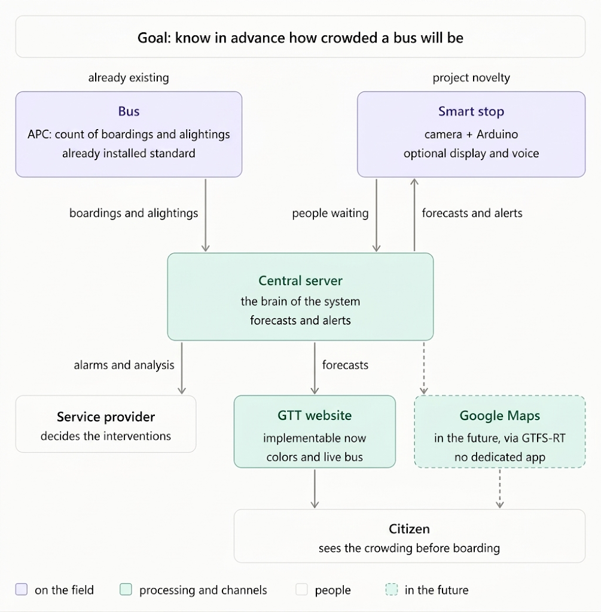
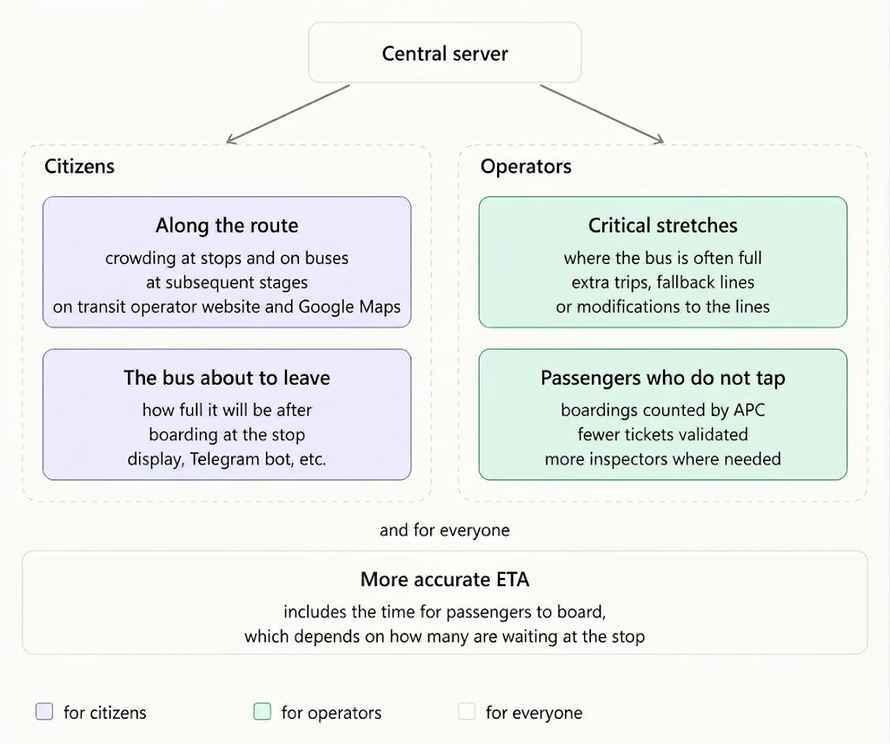

# Bus Crowding Monitor - Predictive Crowding System for Public Transport

A prototype that combines on-board passenger counting (APC + GPS) with smart bus-stop cameras to predict crowding at stops and on buses, with a calibrated confidence that updates in real time. The demo is the **operator dashboard** of the transport company, fed by a simulated world of GTT lines 33 and 42 in Turin and by one physical smart stop built on an Arduino UNO Q.

**Delivery target:** October 11, 2026, 16:00 Europe/Rome.
**Runtime:** localhost for the demo.
**Stack:** Python/FastAPI (one backend with simulator and core), React/TypeScript (frontend), SQLite via SQLAlchemy, Arduino UNO Q (physical smart stop).

| Document | For | Content |
| --- | --- | --- |
| `README.md` (this file) | People | Vision, value, demo, quickstart |
| [`docs/SPEC.md`](docs/SPEC.md) | Developers and AI agents | Single source of truth: architecture, contracts, data model, prediction logic |
| [`AGENTS.md`](AGENTS.md) | AI agents and contributors | Working rules, commands, Definition of Done |
| [`docs/tasks/`](docs/tasks/README.md) | Whoever builds a system | Assignable tasks per system, with priorities and acceptance commands |



---

## Vision and business value

The system moves public transport from passive measurement to predictive management. It does not only count people: it forecasts crowding, adjusts expectations as live data arrives, and detects anomalies.

- **Operator (B2B):** a business intelligence tool to optimize the fleet, find service flaws, and quantify lost demand and revenue.
- **Citizen (B2C):** a reliability index for each journey that tells the passenger in advance how crowded the stop and the bus will be.

### The given (APC) vs. the novelty (smart stops)

- **APC measures the supply.** Automatic Passenger Counting is the industry standard. It tracks boardings and alightings, so the system knows how many people are on the bus. It is blind to what happens outside the doors.
- **Smart stops measure the demand.** A camera at each stop counts people waiting. This unlocks three capabilities:
  1. **Live prediction.** Downstream crowding is predicted from live demand, not only from historical averages.
  2. **The APC blind spot.** If 30 people wait and a full bus takes 5, the APC records "+5". The camera sees the 25 left behind: unserved demand and lost fares become measurable.
  3. **Proactive alerts.** A sudden crowd is detected before the next bus arrives, giving the operator time to react.

![Data flow at each stop. Italian labels: "Prima" = before arrival, people waiting, requested by the server; "Bus riparte" = bus departs, boarded, alighted and onboard; "Dopo 10 s" = 10 s later, people still waiting; "Dati passati" = history for training. The central server compares the past with what happens now and corrects the prediction at every data point. Outputs: next stops (crowding level with reliability in %, to stop and citizen), lost demand (who did not board, unsold tickets, to operator), alerts (sudden crowd, full bus, anomalies, to operator)](docs/image2.png)

*Data flow at each stop (labels in Italian): before arrival, at departure and 10 s later, fused with history.*



### Return on investment

1. **Unmet demand analysis:** quantify passengers left behind and the missed fares they represent.
2. **Fleet and route optimization:** cut empty runs and deploy high-capacity vehicles where data shows chronic bottlenecks.
3. **Targeted fare-evasion enforcement (future):** compare APC counts with validated tickets to find evasion spikes by route and time.

### Hardware principles

- **Zero-touch fleet integration.** The backend ingests the operator's existing APC and GPS/AVL streams. No changes to the buses.
- **Edge cameras.** Counting runs on the device at the stop. The demo uses an **Arduino UNO Q**: its Linux MPU runs the counting model and a small HTTP server, and its MCU drives peripherals.
- **Production proposal (not in the demo):** a self-powered stop kit (XIAO ESP32-S3 Sense + LoRaWAN + solar, about €37 per stop) with a 4G LoRaWAN gateway, rolled out in phases. See the [business infographic](docs/business-infographic-en.svg).
- **Privacy by design.** No frames or faces are stored or transmitted. The device converts images into a number and discards them.

### Future work

Improved ETA and a GTFS-Realtime feed (crowding in Google Maps, Apple Maps and Moovit without a dedicated app), GTT website integration, Telegram bot and voice at the stop, fare-evasion analysis, the ESP32 + LoRa kit, authentication and deployment. None of these is built for the demo. Details in [SPEC section 1](docs/SPEC.md#1-scope-and-priorities).

---

## The demo

1. The operator dashboard shows lines 33 and 42 on a map, with buses moving and stops coloured by predicted crowding. Every value is labelled observed, predicted or simulated.
2. The simulated clock is accelerated to x10.
3. The `rush_hour` scenario fills the buses on the shared section.
4. A capacity or left-behind alert appears, with its evidence.
5. One stop switches to the physical Arduino camera: real people in front of it move the predictions and their confidence.
6. The operator acknowledges the alert, which resolves when the condition clears.

The citizen app is planned (P2) on the same API. Real route geography comes from the GTT GTFS; bus movements, passenger counts and history are simulated and labelled as such.

## Architecture in short

- **Backend :8000** (one FastAPI process):
  - `app/sim` simulates the world: clock (x1 to x60, pause), passengers, passers-by, buses with APC, cameras.
  - `app/core` ingests those sensor events as if they were real, correlates them into stop visits, fuses history with live counts, runs Monte Carlo predictions and raises alerts.
  - The two packages talk only through two typed interfaces.
- **Arduino UNO Q :8080** answers `GET /count` and shows `POST /display`.
- **Frontend :5173** with the operator dashboard and the demo control panel.

Full design in [`docs/SPEC.md`](docs/SPEC.md).

## Quickstart

> To be verified once the code exists. Commands are defined in [SPEC section 13](docs/SPEC.md#13-dev-environment).

```powershell
# Backend
cd backend
uv sync
uv run python -m app.cli bootstrap --weeks 1
uv run uvicorn app.main:app --host 127.0.0.1 --port 8000

# Frontend (second terminal)
cd frontend
npm ci
npm run dev

# Or both at once
./scripts/dev.ps1

# Arduino mock, when the real device is not available
cd backend
uv run python ../edge/mock_edge.py --port 8080
```

Then open http://localhost:5173.

## Team and status

| Component | Owner | Status |
| --- | --- | --- |
| Backend: simulator, ingestion, correlation, models, prediction, alerts, API | Backend workstream | Specified ([backend-sim](docs/tasks/backend-sim.md), [backend-core](docs/tasks/backend-core.md)) |
| Operator dashboard and demo control panel | Frontend workstream | In progress on the `frontend` branch with labelled mock data; alignment with the spec pending ([tasks](docs/tasks/frontend-operator.md)) |
| Citizen app | Frontend workstream | P2 ([tasks](docs/tasks/frontend-citizen.md)) |
| Physical smart stop (Arduino UNO Q, camera, display) | Hardware colleague | Separate workstream; contract in the spec ([tasks](docs/tasks/edge.md)) |
| Shared documentation | Team | `README.md`, `AGENTS.md`, `docs/` on `main` |

## Honesty note

The models learn the profiles we put into the simulator. No real-world accuracy is claimed. What the demo shows is the mechanism: fusing live stop counts with history produces predictions that react to reality, with a confidence calibrated against simulated data. The endpoints have no authentication, which is acceptable only on localhost.
