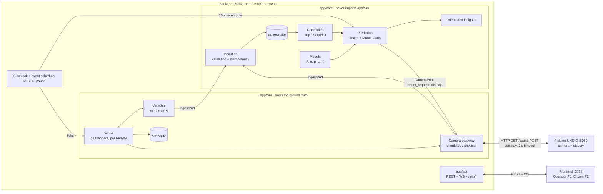
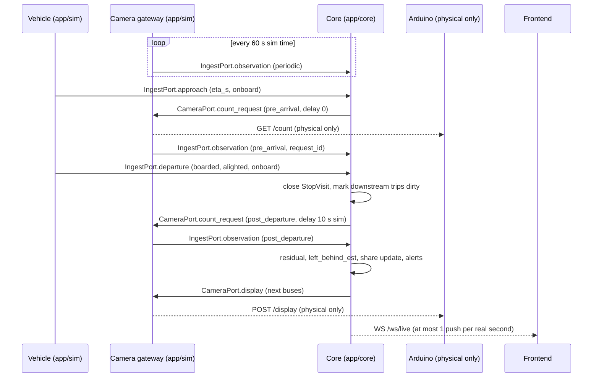
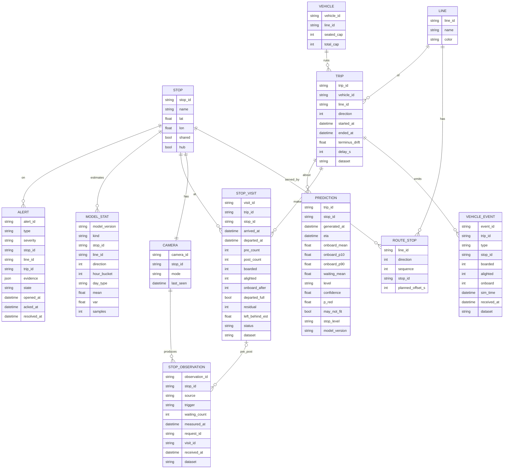
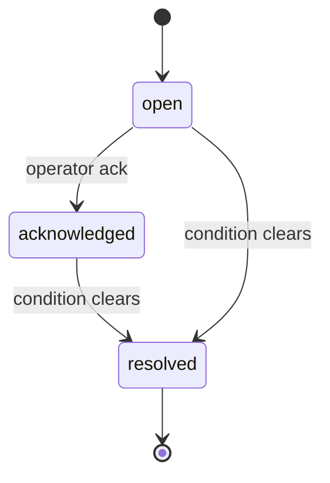

# Bus Crowding Monitor - Technical Specification

## test-v2 P0 implementation overrides (2026-10-11)

These decisions supersede contradictory examples below: only lines 33/42; total capacity 70 assumed, seated capacity unknown (`null`). Bus colour thresholds are green <=60%, yellow <=75%, orange <=90%, red >90%. Boarding risk is separate from colour. Validated reliability is null until P1. The preserved address-only responsive passenger UI is part of this P0 delivery. `/api/journey` also accepts `requested_at` and returns up to three scheduled runs per route pattern with full arrival/departure passages. Scenarios, history training, camera gateway and simulator/core isolation follow this specification. Legacy colleague implementation at backend commit `0c87766a13e9b5c7edb2d19e66da74b2fda2113c` is preserved under `server/` for reference, not started alongside `backend/`.

This is the single source of truth for how the system works: scope, architecture, clock, simulator, message contracts, data model, prediction logic, alerts and environment.

- Human overview and pitch: [`README.md`](../README.md)
- Rules for AI agents and contributors: [`AGENTS.md`](../AGENTS.md)
- Assignable tasks per system: [`docs/tasks/README.md`](tasks/README.md)

When this document and a task file disagree, this document wins. Fix the task file.

---

## 1. Scope and priorities

### Demo focus

The demo is the **operator dashboard** of the transport company. It shows lines 33 and 42 in Turin live, with predicted crowding, calibrated confidence and alerts, while a physical smart stop (Arduino UNO Q) can replace one simulated camera.

- GTT lines **33** and **42**, which share a section of route and some stops. Each line is navigated independently, without transfers. More lines can be added via the GTFS import.
- A single **backend process** runs both the simulated world (clock, passengers, buses, cameras) and the core (ingestion, prediction, alerts, API).
- The simulated clock runs in real time and can be **accelerated (x1 to x60) or paused** from the dashboard.
- One stop can be switched live from its simulated camera to the **physical camera**, and back.
- **Synthetic history** trains the models: 1 week in P0, 5 weeks (4 train + 1 test) in P1.
- Controllable scenarios: `normal`, `rush_hour`, `overcrowding`.
- Seated and total vehicle capacity are both considered.
- Everything runs on localhost. The only network call leaving the laptop goes to the Arduino on the demo LAN.

Real route geography is the target. Bus movements, passenger counts and history are simulated, and are labelled as such everywhere.

### Priorities

P0 is the minimum demo that works end to end. P1 and P2 enrich it. Never start a P1 task while a P0 task of the same system is open, unless the P0 task is blocked.

| System | P0 (demo) | P1 (enrichment) | P2 (later) |
| --- | --- | --- | --- |
| Contracts | C1 contracts, OpenAPI, TS types | | |
| Backend sim | S1 GTFS import, S2 clock + scheduler + buses, S3 passengers, APC, cameras, scenarios, truth, S4 1 week of history, S5 physical camera mode | S6 5 weeks of history (train + test) | |
| Backend core | K1 ingestion + static data + read API + WS, K2 correlation + count-requests, K3 average models + fusion + Monte Carlo + levels + display, K4 alerts CAPACITY_RISK, LEFT_BEHIND, CROWD_ANOMALY, SENSOR_STALE | K5 HistGradientBoosting models, K6 calibration + insights, K7 alerts BUNCHING, APC_DRIFT, POSSIBLE_ABANDONMENT, DATA_INCONSISTENCY | K8 `/api/journey` |
| Frontend operator | O1 skeleton + adapter + types, O2 live map, O3 demo control panel, O4 alerts with ack, O5 stop and bus detail | O6 history, insights, calibration chart | |
| Frontend citizen | | | Z1 map, Z2 journey, Z3 stop detail |
| Edge | E1 Python mock, E2 HTTP server on the Arduino, E3 on-device counting (contract only), E4 basic display | | E5 advanced display |

### Demo script (P0)

1. Open the operator dashboard: lines 33 and 42 on the map, buses moving, stops coloured by level, every value labelled observed, predicted or simulated.
2. Set the clock to x10.
3. Switch the scenario to `rush_hour`. Buses on the shared section fill up and stop levels turn orange and red.
4. A `CAPACITY_RISK` or `LEFT_BEHIND` alert appears with its evidence.
5. Switch the physical stop to the real camera. People in front of the Arduino change the count, and the predicted crowding and confidence of the next buses move visibly.
6. Acknowledge the alert. It resolves automatically when the condition clears.

### Non-goals and future work

Not implemented now. Do not build them, but do not make design choices that block them.

| Item | Why it matters later |
| --- | --- |
| Improved ETA (boarding time from waiting counts) | Crowding data can improve arrival estimates in navigation services. The demo uses the simple ETA of section 9 |
| GTFS-Realtime feed for Google Maps, Apple Maps, Moovit | Output APIs are designed to map to GTFS-RT occupancy fields |
| GTT website integration | Same API as the citizen app |
| Telegram bot, voice announcements at the stop | Extra citizen channels on the same predictions |
| Fare-evasion analysis (APC boardings vs ticket validations) | Needs validation data that the simulator does not produce |
| Production stop kit: XIAO ESP32-S3 + LoRaWAN + solar | Proposal only, see [`business-infographic-en.svg`](business-infographic-en.svg). The demo uses the Arduino UNO Q |
| Authentication, TLS, deployment | Required before any network exposure (section 6) |
| Transfers between lines | Each line is navigated independently |

---

## 2. System architecture



### Component responsibilities

- **SimClock and scheduler** (`app/sim/clock.py`): the single time source for the whole backend. See section 3.
- **Simulator** (`app/sim`)
  - *World:* passenger agents, passers-by, scenarios. It owns the ground truth in `sim.sqlite`.
  - *Vehicles:* buses moving along the GTFS shapes. Each one has APC and GPS and emits `approach` and `departure` events through `IngestPort`.
  - *Camera gateway:* one virtual camera per stop. It emits periodic and on-request observations through `IngestPort` and receives display updates through `CameraPort`. For the physical stop it calls the Arduino over HTTP.
  - *History generator:* the same simulator in batch mode, without real-time pacing.
- **Core** (`app/core`)
  - *Ingestion:* validates payloads, deduplicates by ID, stores raw data.
  - *Correlation:* builds trips and stop visits, and pairs observations with visits.
  - *Models:* arrival rates, alighting fractions, line shares and passer-by estimates, trained on history.
  - *Prediction:* fuses history with live data and propagates crowding along each trip with Monte Carlo sampling.
  - *Alerts and insights:* anomaly rules, alert lifecycle, operator analytics.
- **API** (`app/api`): REST for queries and commands, WebSocket for live push to the frontend, `/sim/*` for demo control. Routes are thin; logic lives in `sim` and `core`.
- **Frontend:** the operator dashboard with the demo control panel (P0) and the citizen app (P2). No persistence.
- **Edge (Arduino UNO Q):** counts people on-device, answers `GET /count`, renders `POST /display`.

### Isolation rule between simulator and core

The core must behave exactly as it would with real sensors.

- `app/sim` and `app/core` communicate **only** through two interfaces defined in `app/contracts/ports.py`, using the Pydantic contract models:
  - `IngestPort` (sim → core): `approach(VehicleApproach)`, `departure(VehicleDeparture)`, `observation(CameraObservation)`. Same validation and idempotency as the HTTP `/ingest/*` routes.
  - `CameraPort` (core → gateway): `count_request(camera_id, CountRequest)`, `display(camera_id, DisplayPayload)`.
- `app/core` never imports `app/sim`. A pytest test scans the imports of every module in `app/core` and fails if it finds `app.sim`.
- `app/core` never reads `sim.sqlite`. Ground truth is exposed only by `GET /sim/truth`, for the validation panel.
- The core gets the current simulated time from a `now()` callable injected at build time (`clock.now`). It never reads the wall clock.
- `app/main.py` and `app/cli.py` are the only modules that import both packages and wire them together.

### Ports

| Service | Port | Binding |
| --- | --- | --- |
| Backend (core + simulator + API) | 8000 | `127.0.0.1` only |
| Arduino UNO Q | 8080 | demo LAN, address in `data/config/sim.yaml` |
| Frontend (Vite dev server) | 5173 | `localhost` |

CORS is enabled on the backend for `http://localhost:5173` only.

### Repository layout

```text
backend/    app/contracts   Pydantic v2 models, ports, ID formats
            app/sim         clock, world, vehicles, camera gateway, scenarios, history
            app/core        ingest, correlation, models, prediction, alerts, db
            app/api         REST routes, WebSocket, /sim/* routes
            app/cli.py      import-gtfs, generate-history, replay, train, bootstrap, export-openapi
            app/main.py     FastAPI app, wiring of sim and core
            tests/          contracts/, sim/, core/, api/, integration/
            pyproject.toml, uv.lock
frontend/   src/operator/   operator dashboard (P0)
            src/citizen/    citizen app (P2)
            src/api/        adapter (mock | live), generated.ts, WS client
            package.json, package-lock.json
edge/       Arduino UNO Q code (HTTP server, counting, display), mock_edge.py
data/       gtfs/           labelled GTFS fixture for lines 33/42
            config/         sim.yaml, model.yaml
            scenarios/      normal.yaml, rush_hour.yaml, overcrowding.yaml
            history/        generated JSONL (gitignored)
scripts/    dev.ps1, gen-types.ps1
docs/       SPEC.md, tasks/, images
AGENTS.md, README.md
```

---

## 3. Clock and scheduler

The backend owns the simulated time. Every timestamp in the system is simulated time, in ISO 8601 with the Europe/Rome offset.

### SimClock

- State: `sim_now`, `speed` (any value in [1, 60], the UI offers x1, x2, x4, x10, x30, x60), `paused`.
- Default start: **Monday 2026-10-12 07:00 Europe/Rome**. Service hours: 06:00 to 23:00.
- Seed: fixed and configurable (`sim.yaml: seed`, default 42). Same seed and same inputs give the same events.

### Event scheduler (discrete-event)

- A heap of `(sim_time, sequence, event)`. `sequence` is an insertion counter that breaks ties deterministically.
- Everything that happens in the world is an event on this heap: passenger arrivals, bus departures from termini, bus arrivals and departures, approach events, periodic camera readings (60 s, with a random per-camera offset), delayed count-requests (post-departure, 10 s), and the core's prediction recompute (every 15 s).
- Core handlers called through `IngestPort` run synchronously inside the event that called them. They may schedule nothing on the heap directly, except through `CameraPort`, which the gateway turns into events.

Real-time loop (asyncio task started on app startup):

```text
every 100 ms of real time:
    real_elapsed = monotonic() - last_tick      # measured, not assumed
    if not paused:
        target = sim_now + speed × real_elapsed
        while heap not empty and heap.peek().sim_time ≤ target:
            event = heap.pop(); sim_now = event.sim_time; event.run()
        sim_now = target
    recompute predictions of trips marked dirty
    if ≥ 1 s real since last WS push: push aggregated deltas
```

- Speed and pause changes take effect on the next tick.
- **Warm-up:** at startup the scheduler runs in batch mode from 06:00 to the start time, so buses and passengers are already in place when the dashboard opens.
- **Batch mode:** `run_until(t_end)` pops events without pacing. Used for warm-up and history. Physical camera mode is not allowed in batch mode.
- **Physical camera reads** are the only asynchronous, non-deterministic part. The reading event starts an `httpx` request without blocking the loop. When the response arrives (or after the 2 s real timeout) the gateway emits the observation with `measured_at = sim_now` at that moment. At most one request per camera is in flight. A reading that falls due while one is in flight is skipped.

### Clock API and WebSocket

- `GET /sim/state` → `{sim_time, speed, paused, scenario, cameras: [{camera_id, mode}]}`
- `POST /sim/clock` with `{"speed": 10}` and/or `{"paused": true}` → new state. Speed outside [1, 60] → `422`.
- `WS /ws/live` sends envelopes `{"type": ..., "sim_time": ..., "data": ...}` with `type` in `clock`, `vehicles`, `stops`, `predictions`, `alerts`. Deltas are aggregated and pushed at most once per real second. A `clock` message is pushed at least once per real second while the socket is open, and on every speed or pause change.

---

## 4. World simulator

The simulator is the only producer of synthetic data. Buses and cameras are *sensors* that observe the simulated world. The core never sees the world directly.

### Agent model

- **Passengers.** Each passenger has an origin stop, a desired line and direction, a destination stop and a patience.
  - Arrivals follow a Poisson process with rate `λ(stop, line, direction, hour, day_type, scenario)`, multiplied by a daily noise factor (events, weather) so that the history is not perfectly regular.
  - The destination is drawn among the downstream stops of that line and direction, with weights proportional to stop attraction (hubs ×3).
  - When a bus of the desired line and direction arrives, waiting passengers board in arrival order (FIFO) while there is room. The others keep waiting.
  - A passenger whose waiting time exceeds their patience leaves the stop. This is the ground truth for abandonment.
  - On board, the passenger alights at the destination.
- **Passers-by.** They walk through the camera's field of view for a few seconds without waiting. They add realistic noise to the counts.
- **Buses.**
  - Trips leave each terminus every *headway* minutes during service hours. Vehicles are assigned greedily to the next trip in the opposite direction that starts at least 3 minutes (layover) after they arrive.
  - Travel time between stops is the GTFS planned difference times a lognormal noise factor. Dwell time depends on boardings and alightings.
  - True onboard starts at 0 at the first terminus and returns to 0 at the last one, where everyone alights.
- **Hubs** are listed in `sim.yaml` (default: shared stops and termini).

### Sensor models

- **APC.** Reported boarded and alighted are the true values times `(1 + ε)`, `ε ~ Normal(0, 0.02²)`, rounded. Reported onboard is the previous reported onboard plus reported boarded minus reported alighted, plus a drift of +1 with probability 0.3 at each stop, clipped at 0. The drift is what the terminus reset exposes.
- **Camera.** True in-frame count `n` = waiting passengers + passers-by currently in frame. Measured count = `round(n × (1 + ε))`, `ε ~ Normal(0, 0.08²)`, minus `round(0.15 × (n − 20))` when `n > 20` (occlusion), clipped at 0.
- **GPS.** Position interpolated along the GTFS shape between stops. Vehicle positions are read by the core from the last events and pushed to the frontend. No separate GPS stream is needed in P0.

### Parameters (initial values, tunable, in `data/config/sim.yaml`)

| Parameter | Value |
| --- | --- |
| Bus capacity (12 m) | 28 seated, 95 total |
| Headway | 10 min per line and direction |
| Fleet per line | `ceil(round_trip_time / headway)` |
| Service hours | 06:00-23:00 |
| Inter-stop travel time | GTFS planned difference (typically 60-120 s) × lognormal noise (σ = 0.1); ×1.15 during peaks and in `rush_hour` |
| Dwell time | 15 s + 2 s per boarding + 1.5 s per alighting |
| Layover at terminus | at least 3 min |
| Approach event | 60 s before arrival, or at departure from the previous stop if the leg is shorter. 60 s before the scheduled departure at the first stop |
| Base arrival rate | 0.5 passengers/min per stop per line and direction |
| Peaks (weekdays) | 07:30-09:00 and 17:00-19:00: ×3 on hubs and on the shared section, ×1.5 elsewhere |
| Weekend | ×0.6, no peaks |
| Daily noise factor | lognormal, σ = 0.15, one value per day and stop |
| Overcrowding scenario | ×10 at one stop (`target_stop_id`) for 20 min |
| Patience | lognormal, median 15 min, σ = 0.5 |
| Passers-by | 1/min per stop, ×3 on hubs (3/min), in frame 5-20 s (uniform) |
| Camera error | gaussian 8%, occlusion 15% of the excess above 20 people |
| APC error | 2% per count, drift +1 with probability 0.3 per stop |
| Camera periodic cadence | 60 s (simulated time), random offset per camera |
| Post-departure count delay | 10 s (simulated time) |
| Seed | 42 |

### Scenarios and ground truth

- Scenarios are YAML files in `data/scenarios/` that override rates and multipliers. `GET /sim/scenarios` lists them, `POST /sim/scenario {"name": "rush_hour"}` switches at runtime.
  - `normal`: the parameters above, peaks by time of day.
  - `rush_hour`: peak multipliers applied now, whatever the clock says.
  - `overcrowding`: `normal` plus ×10 arrivals at `target_stop_id` for 20 min from the switch. Default target: the physical camera stop.
- Ground truth is stored in `sim.sqlite`: every passenger (origin, line, direction, destination, arrival time, outcome: boarded, left behind at least once, abandoned, added or removed by sync) and the true counts per stop and per bus. It is exposed only by `GET /sim/truth`:

```json
{
  "sim_time": "2026-10-12T08:00:22+02:00",
  "kind": "simulated",
  "stops": [{ "stop_id": "gtt-1234", "true_waiting": 22, "true_waiting_by_line": { "33": 11, "42": 11 }, "true_in_frame": 24 }],
  "vehicles": [{ "vehicle_id": "bus-42-03", "trip_id": "42-0-20261012-0730", "true_onboard": 69 }],
  "counters": { "boarded": 1840, "left_behind_events": 12, "abandoned": 7 }
}
```

### History (batch mode)

- `uv run python -m app.cli generate-history --weeks 1 --seed 42` runs the simulator in batch mode for the weeks before the demo start and writes JSONL files (one per message type) to `data/history/`. Ground truth goes to `sim.sqlite` with `dataset = history`.
  - P0: 1 week, 2026-10-05 to 2026-10-11.
  - P1: 5 weeks, 2026-09-07 to 2026-10-11. Train on the first 4 weeks (to 2026-10-04), test on the last one.
- `uv run python -m app.cli replay data/history` loads the JSONL **through the same validation function as `IngestPort`**, with bulk insert in large transactions and no HTTP. Correlation runs on the replayed data.
- Budget: generating and replaying 1 week must take less than 5 minutes on a laptop.
- Raw and derived rows carry `dataset` (`history` or `live`). At backend startup, `live` rows from previous runs are deleted. Static data, history and models are kept.

---

## 5. Stop visit sequence



1. **Periodic count:** each camera reports every 60 s of simulated time.
2. **Approach:** when a bus is about to reach a stop, it emits `approach`. The core opens a stop visit and asks the camera for a fresh pre-arrival count.
3. **Departure:** when the doors close, the bus emits boarded, alighted and onboard. The core closes the bus side of the visit and marks the trips that will visit downstream stops as dirty.
4. **Post-departure count:** 10 s later (simulated time), the camera reports how many people remain. Alighted passengers are assumed to have left the counted area.
5. **Outputs:** the core updates the residual, the estimated left-behind, the line-share estimate and the alerts, then sends a display update to the stop and live deltas to the frontend.

---

## 6. Message contracts: who sends what to whom

All payloads are Pydantic v2 models in `backend/app/contracts`. The OpenAPI schema of FastAPI is the source for the generated TypeScript types (`frontend/src/api/generated.ts`), so frontend and backend cannot drift apart. WebSocket message models are exposed in OpenAPI through `GET /api/ws-schema` so they are generated too.

| Interface | From → To | Transport | Payload |
|---|---|---|---|
| `IngestPort.approach` / `POST /ingest/vehicle/approach` | Sim vehicles → Core | in-process. HTTP route for tests and future real feeds | event_id, vehicle_id, trip_id, line_id, direction, next_stop_id, stop_sequence, eta_s, lat, lon, onboard, sim_time |
| `IngestPort.departure` / `POST /ingest/vehicle/departure` | Sim vehicles → Core | same | event_id, vehicle_id, trip_id, line_id, direction, stop_id, stop_sequence, arrived_at, doors_closed_at, boarded, alighted, onboard, lat, lon, is_terminus |
| `IngestPort.observation` / `POST /ingest/camera/observation` | Gateway → Core | same | observation_id, camera_id, stop_id, source (simulated/physical), measured_at, waiting_count, trigger (periodic/pre_arrival/post_departure), request_id?, visit_id?, device_measured_at? |
| `CameraPort.count_request` | Core → Gateway | in-process only | request_id, visit_id, reason, delay_s. Returns immediately (the old `202 Accepted`); the observation follows through `IngestPort` |
| `CameraPort.display` | Core → Gateway (→ Arduino) | in-process only | stop_id, generated_at, buses[{line_id, eta_s, predicted_onboard, interval_80, level, confidence, may_not_fit}] |
| `GET /count`, `POST /display` | Gateway ↔ Arduino | HTTP on the demo LAN, 2 s timeout | `{count, measured_at}` / display payload, Arduino replies `204` |
| `GET /api/health` | FE → Backend | HTTP | `{status, sim_time, model_version}` |
| `GET /api/lines`, `GET /api/lines/{line_id}` | FE → Backend | HTTP | ordered stops per direction, shape, colour, shared flag |
| `GET /api/stops`, `GET /api/stops/{stop_id}` | FE → Backend | HTTP | observed waiting, passer-by estimate, camera status, next buses with predictions and stop level |
| `GET /api/vehicles`, `GET /api/vehicles/{vehicle_id}` | FE → Backend | HTTP | position, observed onboard, delay, predictions at the downstream stops |
| `GET /api/journey?line&dir&from&to` (P2) | FE → Backend | HTTP | journey stops, next buses, predicted onboard crowding per segment, predicted waiting |
| `WS /ws/live` | Backend → FE | WebSocket | envelopes `{type, sim_time, data}`: clock, vehicles, stops, predictions, alerts |
| `GET /api/ws-schema` | FE tooling → Backend | HTTP | example `WsEnvelope`, exists for type generation |
| `GET /api/operator/alerts`, `POST /api/operator/alerts/{alert_id}/ack` | Operator → Backend | HTTP | alert list (filter by state, severity) and lifecycle |
| `GET /api/operator/history`, `/api/operator/insights`, `/api/operator/calibration` (P1) | Operator → Backend | HTTP | aggregates by stop, line and time bucket; system flaws; reliability chart |
| `GET /sim/state`, `POST /sim/clock` | Demo control → Sim | HTTP | clock state; speed and pause |
| `GET /sim/scenarios`, `POST /sim/scenario` | Demo control → Sim | HTTP | scenario list; scenario switch |
| `GET /sim/cameras`, `POST /sim/cameras/{camera_id}/mode` | Demo control → Sim | HTTP | camera modes; `{"mode": "simulated" or "physical"}`. `409` if the camera has no configured Arduino |
| `GET /sim/truth` | Demo control → Sim | HTTP | ground truth for validation (section 4) |

### ID formats

Validated by regex in the contracts.

| ID | Format | Example |
| --- | --- | --- |
| stop_id | `gtt-{GTFS stop_id}` | `gtt-1234` |
| camera_id | `cam-{GTFS stop_id}` | `cam-1234` |
| vehicle_id | `bus-{line}-{nn}` | `bus-42-03` |
| trip_id | `{line}-{direction}-{yyyymmdd}-{hhmm}` (start time at the first stop) | `42-0-20261012-0730` |
| visit_id | `visit-{trip_id}-s{stop_sequence}` | `visit-42-0-20261012-0730-s12` |
| event_id | `{trip_id}-s{stop_sequence}-{approach or departure}` | `42-0-20261012-0730-s12-departure` |
| observation_id | `obs-{camera_id}-{yyyymmddThhmmss}-{trigger}` | `obs-cam-1234-20261012T075202-post_departure` |
| request_id | `req-{8 hex}` | `req-8f2c41d0` |
| alert_id | `alr-{8 hex}` | `alr-03b7e9a1` |

### Example payloads

IDs and timestamps below are illustrative. Real stop IDs come from the GTFS import.

`IngestPort.approach` / `POST /ingest/vehicle/approach`

```json
{
  "event_id": "42-0-20261012-0730-s12-approach",
  "vehicle_id": "bus-42-03",
  "trip_id": "42-0-20261012-0730",
  "line_id": "42",
  "direction": 0,
  "next_stop_id": "gtt-1234",
  "stop_sequence": 12,
  "eta_s": 60,
  "lat": 45.0712,
  "lon": 7.6851,
  "onboard": 55,
  "sim_time": "2026-10-12T07:50:10+02:00"
}
```

`IngestPort.departure` / `POST /ingest/vehicle/departure`

```json
{
  "event_id": "42-0-20261012-0730-s12-departure",
  "vehicle_id": "bus-42-03",
  "trip_id": "42-0-20261012-0730",
  "line_id": "42",
  "direction": 0,
  "stop_id": "gtt-1234",
  "stop_sequence": 12,
  "arrived_at": "2026-10-12T07:51:10+02:00",
  "doors_closed_at": "2026-10-12T07:51:52+02:00",
  "boarded": 9,
  "alighted": 3,
  "onboard": 61,
  "lat": 45.0703,
  "lon": 7.6869,
  "is_terminus": false
}
```

`IngestPort.observation` / `POST /ingest/camera/observation`

```json
{
  "observation_id": "obs-cam-1234-20261012T075202-post_departure",
  "camera_id": "cam-1234",
  "stop_id": "gtt-1234",
  "source": "physical",
  "measured_at": "2026-10-12T07:52:02+02:00",
  "waiting_count": 7,
  "trigger": "post_departure",
  "request_id": "req-8f2c41d0",
  "visit_id": "visit-42-0-20261012-0730-s12",
  "device_measured_at": "2026-10-11T15:12:44+02:00"
}
```

`device_measured_at` is the Arduino's wall-clock time, kept for logs only. `measured_at` is always simulated time.

`CameraPort.count_request`

```json
{
  "request_id": "req-8f2c41d0",
  "visit_id": "visit-42-0-20261012-0730-s12",
  "reason": "post_departure",
  "delay_s": 10
}
```

`CameraPort.display` (forwarded unchanged as `POST /display` to the Arduino)

```json
{
  "stop_id": "gtt-1234",
  "generated_at": "2026-10-12T07:52:03+02:00",
  "buses": [
    {
      "line_id": "33",
      "eta_s": 240,
      "predicted_onboard": 71,
      "interval_80": [58, 84],
      "level": "yellow",
      "confidence": 0.68,
      "may_not_fit": false
    },
    {
      "line_id": "42",
      "eta_s": 540,
      "predicted_onboard": 92,
      "interval_80": [80, 95],
      "level": "orange",
      "confidence": 0.55,
      "may_not_fit": true
    }
  ]
}
```

Arduino `GET /count` response

```json
{ "count": 4, "measured_at": "2026-10-11T15:12:44+02:00" }
```

`GET /api/stops/{stop_id}` (values from the worked example in section 9)

```json
{
  "stop_id": "gtt-1234",
  "name": "Example stop",
  "lines": ["33", "42"],
  "shared": true,
  "camera": { "camera_id": "cam-1234", "mode": "simulated", "status": "ok" },
  "waiting": { "value": 24, "kind": "observed", "measured_at": "2026-10-12T07:59:52+02:00", "source": "simulated" },
  "passersby_estimate": { "value": 2, "kind": "predicted", "model_version": "v0.1" },
  "next_buses": [
    {
      "line_id": "42",
      "direction": 0,
      "trip_id": "42-0-20261012-0750",
      "vehicle_id": "bus-42-05",
      "eta": { "value": "2026-10-12T08:01:52+02:00", "kind": "predicted" },
      "waiting_for_line": { "value": 11.7, "kind": "predicted", "interval_80": [8, 15], "generated_at": "2026-10-12T08:00:22+02:00" },
      "stop_level": "green",
      "onboard_at_departure": {
        "value": 75,
        "kind": "predicted",
        "interval_80": [70, 79],
        "level": "yellow",
        "confidence": 0.69,
        "may_not_fit": false,
        "generated_at": "2026-10-12T08:00:22+02:00",
        "model_version": "v0.1"
      }
    }
  ]
}
```

`GET /api/journey` (P2, one stop item)

```json
{
  "stop_id": "gtt-1240",
  "sequence": 15,
  "eta": { "value": "2026-10-12T08:01:30+02:00", "kind": "predicted" },
  "waiting": { "value": 14, "kind": "observed", "measured_at": "2026-10-12T07:59:00+02:00", "source": "simulated" },
  "onboard_at_departure": {
    "value": 78,
    "kind": "predicted",
    "interval_80": [64, 91],
    "level": "orange",
    "confidence": 0.61,
    "generated_at": "2026-10-12T07:59:15+02:00",
    "model_version": "v0.3"
  }
}
```

`WS /ws/live` envelope

```json
{
  "type": "clock",
  "sim_time": "2026-10-12T08:00:22+02:00",
  "data": { "speed": 10, "paused": false, "scenario": "rush_hour" }
}
```

### Common rules

- **Time:** all timestamps are simulated time in ISO 8601 with offset. `received_at` is added by the core and is simulated time too.
- **Idempotency:** `event_id` and `observation_id` are unique. A duplicate is ignored: `IngestPort` returns `duplicate`, the HTTP route returns `200` with `{"duplicate": true}`. A new message returns `201` over HTTP. Invalid payloads raise a validation error in-process and `422` over HTTP.
- **Freshness:** an observation older than 3 periods (180 s of simulated time) is stale. Stale or missing data is *unavailable* (`value: null`, `status: "stale"`), never zero.
- **Provenance:** every value exposed to the frontend carries `kind` (observed, predicted or simulated) and its timestamp (`measured_at` or `generated_at`). Observed values also carry `source` (simulated or physical sensor).
- **Contracts first:** a change to a contract model is a change to this section. Regenerate the TypeScript types in the same change.
- **Security:** the backend has **no authentication**. This is acceptable only because it binds to `127.0.0.1`. The Arduino endpoints on the demo LAN are also unauthenticated: use a private network for the demo. Before any network exposure: API keys for ingestion and for the Arduino (`X-Api-Key`), operator authentication and TLS.

---

## 7. Data model



### Table groups (`server.sqlite`)

| Group | Tables | Rules |
| --- | --- | --- |
| Static | LINE, STOP, ROUTE_STOP, VEHICLE, CAMERA | Loaded from the GTFS fixture and `sim.yaml`. `STOP.shared` is true when the stop is served by more than one line. `STOP.hub` comes from `sim.yaml`. `CAMERA.mode` is `simulated` or `physical` |
| Raw | VEHICLE_EVENT, STOP_OBSERVATION | Append-only, never updated. Both `measured_at`/`sim_time` and `received_at` are kept |
| Derived | TRIP, STOP_VISIT, PREDICTION, ALERT | Recomputable from raw data. PREDICTION keeps the latest row per (trip, stop) plus a sampled history (1 row per trip, stop and minute) used for calibration |
| Models | MODEL_STAT | One row per (model_version, kind, stop, line, direction, hour_bucket, day_type). `kind` is `arrival` (λ̂, per second), `alight` (α̂), `share` (p_L), `passerby` (π̂) or `waiting` (waiting-count profile for CROWD_ANOMALY). `line_id` and `direction` are empty when not relevant. P1 tree models are stored as joblib files in `backend/artifacts/{model_version}/` |

`hour_bucket` is the hour of day (0-23). `day_type` is `weekday` or `weekend`. The database is SQLite accessed through SQLAlchemy 2. That is enough for localhost, and the same models can be migrated to PostgreSQL.

### Data ownership: who stores what

| Component | Stores | Does not store |
| --- | --- | --- |
| Simulator (`sim.sqlite`) | Ground truth: passengers (origin, line, destination, outcome) and true counts per stop and per bus | Predictions |
| Core (`server.sqlite`) | Static data, raw events and observations, derived visits, model statistics, predictions, alerts | Ground truth |
| Frontend | Nothing persistent; view state only | Any data |
| Arduino UNO Q | Only the last count and the last display payload, in memory | Images or video frames |

---

## 8. Correlation logic

- `approach` opens a STOP_VISIT for (trip, stop) and sends a pre-arrival count-request. The pre-arrival observation is linked to it by `request_id` and `visit_id`.
- `departure` closes the bus side: boarded, alighted, onboard_after, and `departed_full = onboard ≥ 0.95 × total_capacity`. It sends the post-departure count-request with `delay_s = 10`.
- The post-departure observation gives `residual = post_count`, and the estimated left-behind for the line (π̂ and p_L are defined in section 9):

```text
left_behind_est = max(residual − π̂ − λ̂_tot · 10 s − (1 − p_L) · max(pre_count − π̂, 0), 0)
```

  - At a stop served by one line, `p_L = 1` and the last term vanishes.
  - If the bus departed **full**, `left_behind_est` is **unserved demand** for that line.
  - If the bus departed with **free capacity**, the residual is demand for **another line** (at shared stops), passers-by or new arrivals, and `left_behind_est` is set to 0.
- A visit whose pre-arrival or post-departure observation is missing or stale keeps `status = incomplete`. It is not used for training shares or passer-by estimates.
- At the last terminus, `terminus_drift = declared onboard` (after everyone alights, the APC should say 0). The trip then resets the onboard count to 0.
- `TRIP.delay_s` = `arrived_at − planned time` at the last visited stop. It feeds the demo ETA.

Example:

| Observation | Waiting at stop | Onboard bus |
| --- | --- | --- |
| Before arrival | 9 | 19 |
| After departure | 4 | 24 |
| Net change | −5 | +5 |

This is consistent with five boardings, but counts alone do not uniquely determine boardings and alightings. People may arrive, leave, board or alight during the interval:

```text
onboard_after = onboard_before + boardings − alightings
waiting_after = waiting_before − boardings + new_arrivals − departures_from_queue
```

The second equation assumes alighted passengers have already left the counted area. The core keeps observed net changes separate from estimated passenger movements.

---

## 9. Models and prediction engine

All constants are in `data/config/model.yaml` (table at the end of this section).

### Trained models

P0 uses **average models** (weighted means and variances per bucket) stored in MODEL_STAT. P1 replaces λ and α with scikit-learn HistGradientBoosting models (K5) and must beat the P0 averages on the test week.

All estimates are computed from `server.sqlite` only, per (stop, line, direction, hour_bucket, day_type):

- **Arrival rate λ̂_L** (per second): on visits that departed with free capacity, `Σ boarded / Σ gap_L`, where `gap_L` is the time since the previous departure of the same line and direction from that stop. Abandonment makes this a slight underestimate, which is acceptable. `λ̂_tot` is the sum over the lines serving the stop.
- **Model variance σ²_model:** the extra-Poisson variance of `boarded − λ̂_L · gap_L` on the same visits: `max(sample variance − mean(λ̂_L · gap_L), 0)`.
- **Alighting fraction α̂:** `Σ alighted / Σ onboard_before`, with `onboard_before = onboard_after − boarded + alighted`.
- **Passer-by estimate π̂(stop, hour, day_type):** people in frame who are not waiting. Estimated from post-departure counts at **non-shared** stops after departures with **free capacity**, when everyone waiting should have boarded: `π̂ = mean(max(post_count − λ̂_tot · 10 s, 0))`. At shared stops, use visits where every line serving the stop departed with free capacity in the previous 60 s. With fewer than 10 such samples, use the median π̂ of non-shared stops for the same hour and day type.
- **Line share p_L** at shared stops: `p_L = boarded_L / max(pre_count − π̂, 1)`, clipped to [0, 1], computed **only on visits where the bus departed with free capacity** (otherwise people left behind would bias it) and weighted by sample count. `Var(p_L)` is the sample variance of the per-visit shares. At stops served by one line, `p_L = 1` and `Var(p_L) = 0`. The share is also updated online after each complete live visit with free capacity (running weighted mean, samples capped at 200).
- **Waiting profile** (for CROWD_ANOMALY): mean and variance of `c_adj` from periodic observations.

Fallback without history: λ and α from the `normal` scenario parameters, `p_L = 1 / number of lines serving the stop` with `Var(p_L) = 0.05`, `π̂` from the passer-by rate × mean time in frame, `σ²_model = μ_h`.

Each trained set carries a `model_version` (`v0.1` for P0 averages, `v0.2+` for P1), stored with every prediction.

### When predictions are recomputed

- When an ingested event concerns a stop, every active trip that will still visit a stop at or after it is marked dirty and recomputed at the next scheduler tick.
- Every 15 s of simulated time, all active trips are recomputed to account for data aging.
- Budget: a full recompute of all active trips takes less than 200 ms (numpy vectorised over the samples).

### Demo ETA

- Next stop: from the latest `approach` (`sim_time + eta_s`).
- Other downstream stops: `trip start + planned_offset_s(stop) + delay_s`, where `delay_s` is the last observed delay of the trip, kept constant.
- No accuracy is claimed. The improved ETA is future work (section 1).

### Historical demand μ_h

People waiting for line L when the bus arrives, without looking at the camera:

```text
μ_h  = λ̂_L(s, hour, day_type) · gap_L + r_L
σ_h² = μ_h + σ²_model(s, hour, day_type)
```

- `gap_L` = ETA of this bus − last departure of line L (same direction) from s. Without a previous departure, use the planned headway.
- `r_L` = `left_behind_est` of the last visit of L at s if that bus departed full, else 0.
- If an earlier trip of the same line will visit s before this one, `gap_L` = ETA of this bus − ETA of the earlier bus, and `r_L = 0` (P0 simplification).

### Live demand μ_l

With the latest non-stale camera count `c` at s, measured after the last departure of any line from s:

```text
c_adj  = max(c − π̂, 0)
Δt     = ETA − measured_at          # new arrivals until the bus arrives
age    = now − measured_at          # how old the data is

μ_l    = p_L · c_adj + λ̂_L · Δt
σ_cam² = (0.08 · c)² + 1 + π̂
σ_l²   = p_L² · σ_cam² + c_adj² · Var(p_L) + λ̂_L · Δt + q · age
```

- The live term applies only to the first upcoming trip of line L at s. Later trips use `μ_h` alone.
- If there is no such observation, or it is stale (older than 180 s), the live term is dropped.

### Demand fusion at a stop (inverse-variance, Kalman-like)

```text
μ  = (μ_h/σ_h² + μ_l/σ_l²) / (1/σ_h² + 1/σ_l²)
σ² = 1 / (1/σ_h² + 1/σ_l²)
```

- Fresh data has a small `σ_l²` and dominates. As data ages, `σ_l²` grows and the estimate slides back towards history.
- A stale or offline camera means `σ_l → ∞`: the live term drops out and the prediction falls back to history, with no ad hoc penalty.
- This is why switching to the physical camera shifts predictions immediately: a real count that contradicts history pulls the fused mean towards it.

### Propagation along the trip (Monte Carlo, N = 500)

Starting from `O₀`, the latest APC onboard count of the trip, for each downstream stop in order and each sample:

```text
D  ~ Normal(μ, σ²), clipped at 0 and rounded   # demand for this line
A  ~ Binomial(O, α̂)                             # alightings (A = O at the last terminus)
B  = min(D, capacity − O + A)                   # boardings, capped by capacity
O' = O − A + B                                  # onboard at departure
```

Demand at different stops is sampled independently. Sampling handles the capacity cap correctly, where a gaussian approximation would not. The random generator is seeded from (trip_id, generated_at) so tests are reproducible.

### Onboard levels

Each sample gets a level, checked in this order (Red takes precedence):

| Level | Condition on the sample |
| --- | --- |
| Red | `B < D`: someone is left behind |
| Orange | `76 < O' ≤ 95` and nobody left behind |
| Yellow | `28 < O' ≤ 76` (at most 80% of total capacity) |
| Green | `O' ≤ 28`: everyone can sit |

- **Displayed level:** the most frequent level across samples. Ties go to the more severe level.
- **confidence** = share of samples in the displayed level, i.e. P(displayed level is correct).
- **p_red** = share of samples that are Red.
- **interval_80** = [p10, p90] of O'.
- **may_not_fit** = P(D > free places) > 0.5, i.e. `p_red > 0.5`.
- Confidence decreases with the prediction horizon (number of stops ahead) and with data age, and increases as fresh camera data arrives along the route. This is what the operator sees changing in real time.

### Stop level

How crowded the stop is for the next bus of line L. `ratio = μ / free_places`, with `μ` the fused demand and `free_places = total_capacity − E[O] + E[A]` at that stop:

| Stop level | Condition |
| --- | --- |
| Green | ratio < 0.5 |
| Yellow | 0.5 ≤ ratio < 0.8 |
| Orange | 0.8 ≤ ratio ≤ 1.0 |
| Red | ratio > 1.0 (more people than places) |

The map colours a stop by the worst stop level among its lines.

### Worked example

Shared stop `gtt-1234` (lines 33 and 42), trip `42-0-20261012-0750`, prediction generated at 08:00:22. The bus is approaching this stop. The previous line 42 bus (trip `42-0-20261012-0730`, departure example in section 6) left at 07:51:52 with free places.

Inputs:

| Symbol | Value | Meaning |
| --- | --- | --- |
| λ̂_42 | 1.0 per minute | arrival rate for line 42 at this hour |
| gap_L | 10 min | ETA 08:01:52, last line 42 departure 07:51:52 |
| r_L | 0 | the previous bus left with free places |
| σ²_model | 6 | extra-Poisson variance |
| c | 24 | periodic camera count at 07:59:52 |
| π̂ | 2 | passers-by |
| p_42, Var(p_42) | 0.5, 0.01 | line share |
| Δt, age | 120 s, 30 s | ETA − measured_at, now − measured_at |
| O₀, α̂ | 70, 0.10 | APC onboard, alighting fraction |

Steps:

```text
μ_h    = 1.0 · 10 + 0                         = 10
σ_h²   = 10 + 6                               = 16

c_adj  = 24 − 2                               = 22
μ_l    = 0.5 · 22 + (1/60) · 120              = 11 + 2 = 13
σ_cam² = (0.08 · 24)² + 1 + 2                 = 3.69 + 3 = 6.69
σ_l²   = 0.25 · 6.69 + 22² · 0.01 + 2 + 0.1 · 30
       = 1.67 + 4.84 + 2 + 3                  = 11.51

μ      = (10/16 + 13/11.51) / (1/16 + 1/11.51)
       = (0.625 + 1.129) / (0.0625 + 0.0869)  = 1.754 / 0.1494 ≈ 11.7
σ²     = 1 / 0.1494                           ≈ 6.69   (σ ≈ 2.6)

E[A]   = 70 · 0.10 = 7,  Var(A) = 70 · 0.1 · 0.9 = 6.3
places = 95 − 70 + 7 = 32  ≫ D, so B = D and nobody is left behind
E[O']  = 70 − 7 + 11.7                        ≈ 74.7
sd(O') = sqrt(6.3 + 6.69)                     ≈ 3.6
P(O' ≤ 76) ≈ Φ((76.5 − 74.7) / 3.6) = Φ(0.5) ≈ 0.69
```

Result: level **yellow**, confidence ≈ 0.69, interval_80 ≈ 74.7 ± 1.28 · 3.6 = [70, 79], `may_not_fit = false`. Stop level for line 42: 11.7 / 32 = 0.37, **green**. The normal approximation is used here only to check by hand. The Monte Carlo result must be close (±0.05 on confidence).

The live count (13) pulls the historical estimate (10) up to 11.7. If the camera goes stale, the prediction returns to μ = 10 with σ² = 16.

### Calibration (P1)

On the test week, among predictions issued at about 70% confidence, about 70% must turn out correct. The outcome is the level computed from the observed APC `onboard_after` and `left_behind_est` of the visit, from `server.sqlite` only. `GET /api/operator/calibration` returns, per confidence bucket of 0.1, the mean confidence, the observed hit rate and the count. Target: every bucket with at least 30 predictions within ±10 points. The demo control panel separately compares predictions with ground truth from `/sim/truth`.

### Stop display

For the next bus of each line, the display shows the predicted O' **at departure from that stop**: current onboard, minus expected alightings, plus expected boardings from that stop. It shows the ETA, the level, the confidence and `may_not_fit`. The core sends a display update after every post-departure observation at that stop and at every 15 s recompute.

### Other formulas (reference)

```text
occupancy_percentage         = onboard / total_capacity × 100
remaining_capacity           = max(total_capacity − onboard, 0)
people_above_seated_capacity = max(onboard − seated_capacity, 0)
estimated_excess_demand      = max(waiting_for_line − remaining_capacity, 0)
```

### Constants (`data/config/model.yaml`)

| Constant | Value | Used in |
| --- | --- | --- |
| `n_samples` | 500 | Monte Carlo |
| `recompute_period_s` | 15 | scheduler |
| `stale_after_s` | 180 | freshness, live term, SENSOR_STALE |
| `q` | 0.1 people²/s | σ_l² aging |
| `cam_rel_error` | 0.08 | σ_cam² |
| `cam_base_var` | 1 | σ_cam² |
| `seated_cap`, `total_cap` | 28, 95 | levels |
| `yellow_max` | 76 | levels |
| `departed_full_ratio` | 0.95 | correlation |
| `post_departure_delay_s` | 10 | correlation, left_behind_est |
| `share_prior_var` | 0.05 | fallback |
| `share_max_samples` | 200 | online share update |
| `passerby_min_samples` | 10 | π̂ fallback |
| `left_behind_threshold` | 5 | LEFT_BEHIND |
| `capacity_risk_open`, `capacity_risk_close` | 0.5, 0.3 | CAPACITY_RISK |
| `crowd_z_open`, `crowd_z_close`, `crowd_var_floor` | 3, 2, 4 | CROWD_ANOMALY |
| `bunching_ratio` | 0.4 | BUNCHING |
| `apc_drift_threshold` | 3 | APC_DRIFT |
| `inconsistency_margin` | 3 | DATA_INCONSISTENCY |
| `edge_timeout_s` | 2 (real time) | camera gateway |

### Honesty note

The models learn the profiles we put into the simulator. No real-world accuracy is claimed. What the demo shows is the mechanism: fusing live stop counts with history produces predictions that react to reality, with a confidence that is calibrated against simulated data.

---

## 10. Alerts and insights

| Alert | Priority | Severity | Opens when | Resolves when |
| --- | --- | --- | --- | --- |
| CAPACITY_RISK | P0 | high | `p_red > 0.5` for a trip at an upcoming stop | `p_red < 0.3`, or the trip has departed from that stop |
| LEFT_BEHIND | P0 | high | the bus departed full and `left_behind_est > 5` | the next visit of the same line departs with free capacity and `left_behind_est ≤ 5` |
| CROWD_ANOMALY | P0 | medium | z-score of `c_adj` against the waiting profile for (stop, hour, day_type) > 3. Variance floor 4 | z < 2 on two consecutive periodic observations |
| SENSOR_STALE | P0 | medium | no observation from a camera for 180 s of simulated time | a new observation arrives |
| BUNCHING | P1 | medium | headway between consecutive departures of the same line and direction at a stop < 40% of planned | the next headway at that stop is ≥ 40% of planned |
| APC_DRIFT | P1 | low | `abs(terminus_drift) > 3` | the next trip of that vehicle ends with `abs(terminus_drift) ≤ 3` |
| POSSIBLE_ABANDONMENT | P1 | low | `c_adj` drops by more than max(3, 30%) between two consecutive periodic observations with no bus visit in between. Labelled as an inference | after 10 min of simulated time |
| DATA_INCONSISTENCY | P1 | low | `boarded > pre_count − π̂ + 3` with a fresh pre-arrival count, or onboard < 0, or alighted > onboard_before | after 10 min of simulated time |

- At most one open or acknowledged alert per (type, stop_id, line_id, trip_id). Repeated triggers update its evidence.
- Every alert stores its evidence (measurements, predictions, timestamps, model_version) and whether each value is observed or predicted.
- Alerts are pushed on the WebSocket when they open, change state or update evidence.



- Acknowledging records that someone has taken ownership. It does not resolve the alert. Acknowledging a resolved alert returns `409`.
- Resolution is automatic when the condition clears.
- The system may suggest an extra service. It never dispatches buses automatically.

### Operator insights (P1, system flaws)

- Lost demand by stop and time bucket (`Σ left_behind_est`), with estimated lost fares (fare from config, default €1.90).
- Chronic overcrowding by line, stop and hour (share of visits with `departed_full`).
- Recurring bunching.
- APC drift per vehicle.
- Camera reliability: stale periods and APC/camera inconsistencies.

---

## 11. Physical camera switch

The physical camera is integrated **through the camera gateway in `app/sim`**, not directly with the core.

- Each camera has a mode, `simulated` or `physical`, set with `POST /sim/cameras/{camera_id}/mode`. Only the camera configured in `sim.yaml` (`physical_camera: {camera_id, base_url}`) can be physical.
- In physical mode, every reading the scheduler calls for (periodic, pre-arrival, post-departure) triggers `GET {base_url}/count` on the Arduino. The Arduino only answers "count now". The cadence comes from the simulator, so the switch works at any clock speed.
- The gateway **syncs the world** to the real count `n`: simulated passers-by are disabled at that stop, and waiting agents are added (line and destination drawn as for normal arrivals) or removed (most recent first) until the stop has `n` waiting agents. Truth records them as `added_by_sync` or `removed_by_sync`. Boardings and APC data stay coherent with what the camera sees.
- The observation reaches the core with `source = "physical"` and `measured_at = sim_now`. The core treats it like any other observation.
- Real people do not board the simulated bus, so after departure they are still in frame. The core sees them as residual demand, which produces a visible alert in the demo. Alternatively, the presenter leaves the frame when the bus departs.
- If the Arduino does not answer within 2 s (real time), the gateway emits no observation and logs a warning. After 180 s of simulated time without observations the core opens SENSOR_STALE, and the prediction falls back to history. No data is invented.
- Switching back to `simulated` resumes from the synced world state.
- Display updates for that stop are forwarded to the Arduino with `POST {base_url}/display`. Failures are logged and ignored.
- Privacy: counting runs on the device, and no frames are saved or transmitted.

---

## 12. Frontend

Stack in section 13. Data access goes through an adapter in `src/api` with two modes, `mock` and `live` (`VITE_API_MODE`). Mocks use the generated types and are labelled as mock data in the UI.

### Operator dashboard (P0)

- **Live map:** Leaflet + OpenStreetMap. Line shapes coloured by line, stops coloured by stop level, buses as markers with their predicted level at the next stop and observed onboard. Live updates via `WS /ws/live`.
- **Alerts:** list sorted by severity then age, with type, stop, line, evidence (observed and predicted values labelled), state, and an acknowledge button.
- **Stop and bus detail:** for a stop, observed waiting (with source and age), passer-by estimate, next buses with ETA, predicted onboard at departure, interval_80, level, confidence and may_not_fit. For a bus, observed onboard, delay, and predictions at each downstream stop.
- **Demo control panel:** clock speed (x1, x2, x4, x10, x30, x60) and pause, scenario selector, camera mode switch for the physical stop, and ground truth against prediction for the selected stop and bus (`/sim/truth`).
- **History, insights and calibration chart** (P1).

### Citizen app (P2)

- Map with live buses and stops.
- Simulated or chosen origin, nearest stop as the starting stop, destination on the same line and direction.
- Journeys that need a transfer or the wrong direction are explained, not shown as valid.
- The journey is colour-coded by predicted level, with the confidence for each segment.
- Zooming on a stop shows observed and predicted waiting, the next buses and the predicted onboard crowding at departure.

### Rules

- Every value is visibly labelled observed, predicted or simulated, with its age.
- Stale or missing values are shown as "unavailable", never as 0.
- Levels are shown with colour **and** text (or icon), never colour alone. Controls are keyboard accessible and have labels.
- A permanent banner states that bus movements and counts are simulated.

---

## 13. Dev environment

| Area | Choice |
| --- | --- |
| Backend | Python 3.12, uv, FastAPI, Uvicorn, SQLAlchemy 2, Pydantic v2, httpx, numpy, scikit-learn (P1), PyYAML, tzdata (needed for Europe/Rome on Windows), pytest, ruff |
| Frontend | Node 20 LTS, npm, Vite, React, TypeScript, react-leaflet + OpenStreetMap, Recharts, TanStack Query, Vitest + Testing Library |
| Types | `openapi-typescript` from the exported OpenAPI schema |
| OS | Windows + PowerShell for the team. Scripts must also run with `pwsh` |

Exact versions are pinned in `pyproject.toml` + `uv.lock` and `package.json` + `package-lock.json`. Both lock files are committed.

| Task | Command |
| --- | --- |
| Install backend | `cd backend; uv sync` |
| Backend tests | `cd backend; uv run pytest` |
| Lint | `cd backend; uv run ruff check .` |
| Bootstrap data | `cd backend; uv run python -m app.cli bootstrap --weeks 1` (GTFS fixture load, history, replay, training) |
| Run backend | `cd backend; uv run uvicorn app.main:app --host 127.0.0.1 --port 8000` |
| Install frontend | `cd frontend; npm ci` |
| Frontend tests | `cd frontend; npm test` (Vitest in run mode) |
| Run frontend | `cd frontend; npm run dev` |
| Generate TS types | `./scripts/gen-types.ps1` (runs `app.cli export-openapi`, then `openapi-typescript` into `frontend/src/api/generated.ts`) |
| Run everything | `./scripts/dev.ps1` (backend and frontend in two windows) |
| Arduino mock | `cd backend; uv run python ../edge/mock_edge.py --port 8080` |

---

## 14. Public data and limitations

- **Geography source:** [GTT GTFS archive](https://www.gtt.to.it/open_data/gtt_gtfs.zip), with context on [Muoversi a Torino open data](https://ls.muoversiatorino.it/it/open-data/). Reuse terms must be checked before redistributing a fixture. The committed fixture is labelled with its source and download date.
- **Pending verification:** the exact routes of lines 33 and 42, their variants and the shared section have not been verified yet. They will be extracted from the GTFS, and shared stops will be computed automatically.
- **Measurements are snapshots** of people present. Do not sum repeated snapshots and call the result unique passengers or throughput.
- **Shared stops:** a waiting count does not identify the intended line. It must never be assigned in full to every bus. The per-line share is an estimate.
- **Stale ≠ zero:** missing or stale observations are unavailable data.
- **Synthetic validation:** tests on simulated data cannot prove physical counter accuracy or real-world prediction accuracy. Field validation is outside the hackathon schedule.

---

## 15. Glossary

| Term | Meaning |
| --- | --- |
| APC | Automatic Passenger Counting: sensors at the bus doors that count boardings and alightings |
| AVL | Automatic Vehicle Location: the GPS position stream of the fleet |
| GTFS | General Transit Feed Specification: static timetable and geography data. GTFS-RT is its real-time extension |
| Headway | Planned time between consecutive buses of the same line and direction |
| Dwell | Time a bus stays at a stop with doors open |
| Trip | One run of a vehicle from first to last terminus in one direction |
| Stop visit | One trip at one stop: approach, arrival, departure, and the camera counts around it |
| Residual | Camera count 10 s after a departure |
| left_behind_est | Estimated people left behind by a full bus (section 8) |
| p_L | Line share: fraction of the people waiting at a shared stop who want line L |
| π̂ | Passer-by estimate: people in frame who are not waiting |
| c, c_adj | Camera count, and camera count minus π̂ |
| λ, λ̂ | True and estimated arrival rate of passengers (per second) |
| α, α̂ | True and estimated fraction of onboard passengers who alight at a stop |
| μ_h, μ_l, μ | Historical, live and fused demand for a line at a stop |
| D, A, B, O, O' | Monte Carlo demand, alightings, boardings, onboard before and after the stop |
| kind | Provenance of a value: `observed` (from a sensor, simulated or physical, see `source`), `predicted` (from the models), `simulated` (ground truth, only on `/sim/*`) |
| Stale | An observation older than 180 s of simulated time. Treated as unavailable, never as 0 |
| P0, P1, P2 | Priority levels (section 1) |

---

## 16. Decision record

| Date | Decision |
| --- | --- |
| 2026-10-10 | Separate passenger and operator interfaces with a shared backend. |
| 2026-10-10 | Python/FastAPI backend and React/TypeScript frontend. |
| 2026-10-10 | Real GTT lines, independently navigated without transfers. |
| 2026-10-10 | Simulated origin, nearest initial stop, selected destination, and route crowding. |
| 2026-10-10 | Operator priorities: critical situations, acknowledgement, then analytics. |
| 2026-10-10 | Controlled scenarios, synthetic history, and localhost delivery. |
| 2026-10-10 | Hardware colleague handles stop counting; backend workstream handles the central server. |
| 2026-10-10 | APC departure events, timed stop observations, and visit correlation. |
| 2026-10-10 | Occupancy forecasts, anomalies, and output for stop displays. |
| 2026-10-10 | Frontend continues with mocks on the `frontend` branch; shared README on `main`. |
| 2026-10-11 | Lines 33 and 42, with a shared section and shared stops. |
| 2026-10-11 | A single world simulator with an agent-based passenger model feeds buses and cameras. |
| 2026-10-11 | The physical camera is switched through the camera gateway in the simulator. |
| 2026-10-11 | A bus `approach` event triggers a pre-arrival count; the post-departure count is taken 10 s later (simulated time). |
| 2026-10-11 | SQLite via SQLAlchemy; contracts as Pydantic models. |
| 2026-10-11 | Synthetic history: 4 weeks of training and 1 week of test (P1), 1 week in P0. |
| 2026-10-11 | Inverse-variance fusion of history and live data, with Monte Carlo confidence and calibration. |
| 2026-10-11 | The stop display shows predicted onboard crowding at departure from that stop. |
| 2026-10-11 | Bus capacity of 28 seated and 95 total. |
| 2026-10-11 | Real people remaining after a simulated departure are treated as residual demand. |
| 2026-10-11 | **Single backend process on :8000** containing simulator and core. They talk only through `IngestPort` and `CameraPort`; `app/core` never imports `app/sim`. Replaces the separate simulator on :8001 and the `shared/` package. |
| 2026-10-11 | The backend owns the simulated clock: discrete-event scheduler, real-time pacing x1 to x60, pause, controlled from the dashboard. |
| 2026-10-11 | HTTP only towards the Arduino and the frontend; WebSocket only from backend to frontend. |
| 2026-10-11 | Priorities P0/P1/P2. The demo is centred on the operator dashboard; the citizen app is P2. |
| 2026-10-11 | Passers-by are estimated (π̂) and subtracted from counts, line shares and left-behind estimates. Passer-by rate raised to 1/min (3/min on hubs). |
| 2026-10-11 | Levels are assigned per Monte Carlo sample, Red takes precedence; the displayed level is the mode. Stop levels compare waiting demand with free places. |
| 2026-10-11 | Demo ETA = planned GTFS offset + last observed delay. Improved ETA and GTFS-RT are future work. |
| 2026-10-11 | Demo hardware is the Arduino UNO Q. ESP32-S3 + LoRaWAN + solar is a production proposal only. |
| 2026-10-11 | Telegram, voice, fare-evasion analysis and GTT website integration are future work. |
| 2026-10-11 | Model statistics are stored in one MODEL_STAT table (replaces LINE_SHARE). |
| 2026-10-11 | History is replayed through the same validation as live ingestion, with bulk insert, not HTTP. |

## 17. Remaining decisions

- Verify the routes of 33/42, their variants and the shared section from the GTFS (task S1).
- Person-counting model and display hardware on the Arduino UNO Q: chosen by the hardware colleague (tasks E3, E4).
- Alignment with the existing frontend code on the `frontend` branch: pending, the team will specify which code to follow (task O1).
- Tune the simulation parameters and alert thresholds after the first runs, so that `rush_hour` produces at least one CAPACITY_RISK on the shared section within 10 simulated minutes.
- Authentication and TLS before any non-localhost exposure.


### Operator history implementation (section 6 addendum)

The operator-only UI now uses `GET /api/operator/history`, defined in `backend/app/contracts/history.py` and the generated OpenAPI/TypeScript schemas. It provides hourly/daily observation means, sample coverage and stop ranking over the synthetic archive. Periodic stop samples are weighted by their sample counts; occupancy uses after-departure APC samples, with assumed capacity. Null gaps stay unavailable. Route filters preserve shared-stop waiting totals, so the UI explicitly distinguishes total stop crowds from a line's vehicle load.

Decision: cache grouped historical observations in process because the archive contains over one million periodic samples; the archive is rebuilt only offline and requires a server restart. This iteration implements observational history, not validated model reliability, historical sensor uptime, or causal abandonment attribution. The rounded responsive operator workspace shares the citizen view's green palette and card/touch design. There is no new public exposure or authentication claim.
