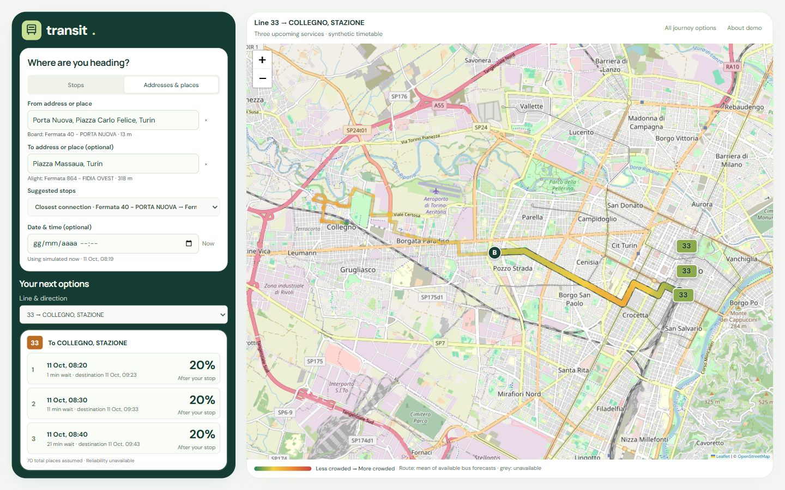
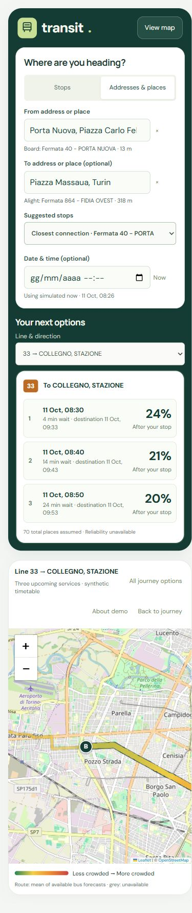

# Passenger interface: responsive review

Reviewed on 11 October 2026. Branch: `frontend-v3-responsive`.
Previous working version: `frontend-v3-auto-stops`, commit `e5ceb786857b9ea7f3c92662dc80ab4592bddeb9`.

## 1. Search and initial state — improved

The previous page used a full-height green strip that continued behind empty space and the loading state. Its straight boundary made the search and map feel disconnected.

The green background now belongs to a rounded journey panel containing the Transit brand, search and trip options. The map has its own rounded surface, with a consistent gap and outer margins. Before a stop is chosen, the panel fits its content. Loading uses a centred brand and status card instead of the split background.

## 2. Desktop journey — verified

At widths of 980 px and above, controls remain on the left and the map on the right. The page fits the viewport at the tested desktop sizes. Short windows use a compact two-column search form; selecting a bus expands its details within the existing card. The initial 1366 × 600 check exposed clipped trip rows; the compact rules were corrected and the rows rechecked against their content heights.

## 3. Smartphone journey — verified in browser emulation

Below 980 px the search, options and map stack vertically. Input text is 16 px; search controls, result rows, map zoom controls and invisible bus/stop hit areas have at least 44 px height. Visible bus icons remain small. Long instructions wrap, and the selected bus details grow naturally rather than being squeezed into a fixed desktop height.

“View map” and “Back to journey” move between sections. Their scrolling respects reduced-motion preferences. Both actions were exercised, and returning to the journey restored the top of the controls to 16 px from the viewport edge.

## Verification

| Viewport | Layout | Result |
| --- | --- | --- |
| 320 × 740 | Phone, stacked | No horizontal overflow; trip text fits |
| 390 × 844 | Phone, stacked | No horizontal overflow; search, map navigation and inline details exercised |
| 768 × 1024 | Tablet, stacked | No horizontal overflow; two-column search |
| 980 × 720 | Desktop | Page fits; three trip rows fit |
| 1280 × 720 | Desktop | Page fits; three trip rows fit |
| 1366 × 600 | Short desktop | Page fits; trip rows and selected bus details fit |
| 1440 × 900 | Desktop | Page fits; screenshot inspected |
| 1920 × 1080 | Large desktop | Page fits; three trip rows fit |

The journey used for verification was Porta Nuova → Piazza Massaua, with automatically suggested boarding/alighting stops and line 33. Live place search, automatic selection, three upcoming services and bus selection were exercised. Production build and the existing domain, journey and place-search test suite passed.

The scope is presentation and navigation. Route matching, synthetic predictions, capacity assumptions and the operator workflow remain unchanged. Backend/Arduino integration remains deferred.

## Limits and follow-up

These checks used browser viewport emulation and DOM geometry, not physical phones. Native keyboard behaviour, iOS date inputs, screen readers and device-specific performance still require real-device checks. This review does not establish accessibility compliance. Very small heights outside the tested sizes may require scrolling. Suggested-stop select menus abbreviate long choices; the chosen boarding and alighting stops are also shown separately under the address fields.

Before screenshots and the selected-bus mobile screenshot are stored alongside this report. The per-viewport measurements are in `ui-audit-responsive/viewport-checks.json`.
