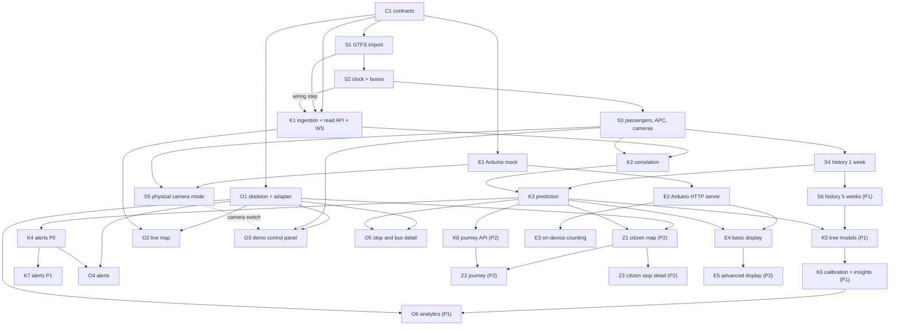

# Tasks per system

Each file is assignable on its own to one person or one AI agent. Rules, commands and Definition of Done are in [`AGENTS.md`](../../AGENTS.md); the design is in [`SPEC.md`](../SPEC.md).

| File | System | Folders it may edit | Tasks |
| --- | --- | --- | --- |
| [`contracts.md`](contracts.md) | Contracts and repo skeleton | `backend/` (skeleton, `app/contracts`, `app/main.py`), `scripts/`, `data/config/` | C1 |
| [`backend-sim.md`](backend-sim.md) | Simulator | `backend/app/sim`, `backend/app/api/sim_routes.py`, sim subcommands in `backend/app/cli.py`, `backend/tests/sim`, `data/gtfs`, `data/scenarios`, `data/config/sim.yaml` | S1-S6 |
| [`backend-core.md`](backend-core.md) | Core | `backend/app/core`, `backend/app/api` (except `sim_routes.py`), `backend/app/main.py`, core subcommands in `backend/app/cli.py`, `backend/tests/core`, `backend/tests/api`, `backend/tests/integration`, `data/config/model.yaml` | K1-K8 |
| [`frontend-operator.md`](frontend-operator.md) | Operator dashboard | `frontend/` (except `src/citizen`), `scripts/dev.ps1` | O1-O6 |
| [`frontend-citizen.md`](frontend-citizen.md) | Citizen app | `frontend/src/citizen` | Z1-Z3 |
| [`edge.md`](edge.md) | Arduino UNO Q and its mock | `edge/` | E1-E5 |

## Priorities

- **P0:** the demo of [SPEC section 1](../SPEC.md#demo-script-p0). Must be done.
- **P1:** enrichment. Start only when the P0 tasks of the same system are done or blocked.
- **P2:** later.

## Dependency graph

## P0 path

The order gets a first end-to-end slice (buses moving on the dashboard) as early as possible.

1. **C1** contracts and skeleton. Everything depends on it.
2. **S1** GTFS import.
3. In parallel: **S2** clock and buses, **K1** ingestion and read API, **O1** frontend skeleton on mocks, **E1** Arduino mock.
4. **K1 wiring step** + **O2** live map. First demo: buses of 33 and 42 moving at x10 on the dashboard.
5. **S3** passengers, APC and cameras, then **K2** correlation and **S4** history (in parallel), then **K3** prediction and **K4** alerts.
6. **O3**, **O4**, **O5** as the backend pieces land (they can start earlier on mocks).
7. **S5** physical camera mode with the mock, then **E2**, **E3**, **E4** on the real Arduino.
8. Rehearse the demo script, then P1 if time remains.

## Coverage check

Every endpoint and interface of [SPEC section 6](../SPEC.md#6-message-contracts-who-sends-what-to-whom) is owned by a task:

| Endpoint or interface | Task |
| --- | --- |
| Contract models, `IngestPort`, `CameraPort`, ID formats, `GET /api/health`, `GET /api/ws-schema` | C1 |
| `GET /sim/state`, `POST /sim/clock` | S2 |
| `GET /sim/scenarios`, `POST /sim/scenario`, `GET /sim/truth`, `CameraPort` (simulated) | S3 |
| `GET /sim/cameras`, `POST /sim/cameras/{camera_id}/mode`, gateway ↔ Arduino HTTP | S5 |
| `IngestPort`, `POST /ingest/*`, `GET /api/lines*`, `GET /api/stops*`, `GET /api/vehicles*` (observed), `WS /ws/live` | K1 |
| Count-requests through `CameraPort` | K2 |
| Predictions in `/api/stops*`, `/api/vehicles*`, WS `predictions`, `CameraPort.display` | K3 |
| `GET /api/operator/alerts`, `POST /api/operator/alerts/{alert_id}/ack`, WS `alerts` | K4 |
| `GET /api/operator/calibration`, `/api/operator/insights`, `/api/operator/history` | K6 |
| `GET /api/journey` | K8 |
| Arduino `GET /count`, `POST /display` | E1 (mock), E2 (device) |
