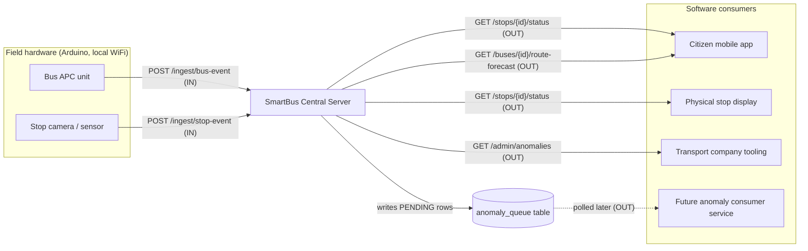

# 🚌 SmartBus Central Server

> AI-powered real-time public transport intelligence for Smart Cities


---

## Overview

A central backend server that ingests real-time data from buses (via APC units) and smart bus stops (via Arduino cameras/sensors), correlates events, predicts crowdedness and adjusted ETAs, detects anomalies, and exposes a REST API for citizen mobile apps and physical stop displays.

This project is built for the **HackTurin** hackathon, simulating the GTT public transport network in Turin, Italy.

**Key capabilities:**
- Real-time ingestion from Arduino-based hardware over local WiFi
- Event correlation: cross-references bus and stop data to compute boarding/alighting counts
- ML-powered crowdedness prediction (% occupancy on arrival AND after boarding) for all upcoming stops
- ETA adjustment that accounts for boarding time, compared side-by-side with the official GTT schedule
- Anomaly detection with a queue-based design ready for a future consumer service
- Simple API key authentication for all endpoints

---

## Architecture

```mermaid
graph TD
    subgraph Hardware["Hardware Layer (Local WiFi)"]
        BUS[Bus APC Unit\nArduino]
        STOP[Bus Stop Camera\nArduino]
    end

    subgraph Server["Central Server (FastAPI)"]
        INGEST_BUS[POST /ingest/bus-event]
        INGEST_STOP[POST /ingest/stop-event]
        CORRELATOR[Event Correlator\nmatches bus↔stop events]
        PREDICTOR[Prediction Engine\nML + Rule-based]
        ANOMALY[Anomaly Detector]
        QUEUE[Anomaly Queue Table\nready for consumer]
        API_OUT[Output API\nGET /stops/{id}/status\nGET /buses/{id}/route-forecast]
    end

    subgraph DB["SQLite Database"]
        T1[(bus_events)]
        T2[(stop_events)]
        T3[(correlated_events)]
        T4[(predictions)]
        T5[(anomaly_queue)]
        T6[(routes & stops & schedule)]
    end

    BUS -->|POST JSON + API Key| INGEST_BUS
    STOP -->|POST JSON + API Key| INGEST_STOP
    INGEST_BUS --> CORRELATOR
    INGEST_STOP --> CORRELATOR
    CORRELATOR --> T3
    CORRELATOR --> PREDICTOR
    PREDICTOR --> T4
    PREDICTOR --> ANOMALY
    ANOMALY --> T5
    INGEST_BUS --> T1
    INGEST_STOP --> T2
    API_OUT --> T4
    API_OUT --> T6
```

---

## Data Flow: The Correlation Logic

When a bus leaves a stop, a `bus_event` is stored. The server then waits for a matching `stop_event` from the same stop (within a 30-second window). Once both arrive, the correlator computes:

- `people_boarded` = bus occupancy after − bus occupancy before
- `people_alighted` = stop crowd before − stop crowd after − people boarded
- `dwell_time_actual` = time between door open and door close

This correlated data feeds the prediction engine to update the forecast for all upcoming stops on the bus's route.

```
BUS leaves Stop X  →  bus_event stored  →  wait for stop_event from Stop X
                                            (within 30s window)
                                                ↓
                                    Correlator computes:
                                    - people_boarded
                                    - people_alighted
                                    - dwell_time_actual
                                                ↓
                                    Predictor updates forecast for
                                    all upcoming stops on this bus's route
```

---

## Tech Stack

| Layer | Technology | Reason |
|---|---|---|
| Web Framework | FastAPI | Async, fast, auto OpenAPI docs, ideal for IoT ingestion |
| Database | SQLite (dev) → PostgreSQL-ready | Zero setup for hackathon, SQLAlchemy makes migration trivial |
| ORM | SQLAlchemy | Clean models, DB-agnostic |
| ML Engine | scikit-learn (GradientBoostingRegressor) | Lightweight, no GPU, trains in seconds on simulated data |
| Background Jobs | APScheduler | Runs periodic tasks (model retraining, simulation ticks) |
| Data Generation | pandas + numpy | Simulation and feature engineering |
| Auth | API Key (X-API-Key header) | Simple, secure enough for local WiFi hackathon context |

---

## Project Structure

```
HackTurin/
├── app/
│   ├── main.py                  # FastAPI app entrypoint
│   ├── config.py                # Settings, API keys, constants
│   ├── db/
│   │   ├── database.py          # SQLAlchemy engine & session
│   │   └── init_db.py           # Table creation script
│   ├── models/
│   │   ├── route.py             # Route, Stop, Bus, Schedule models
│   │   ├── events.py            # BusEvent, StopEvent, CorrelatedEvent
│   │   ├── predictions.py       # Prediction model
│   │   └── anomaly.py           # AnomalyQueue model
│   ├── schemas/
│   │   ├── ingest.py            # Pydantic schemas for incoming data
│   │   └── output.py            # Pydantic schemas for API responses
│   ├── routers/
│   │   ├── ingest.py            # POST /ingest/bus-event, /ingest/stop-event
│   │   ├── public.py            # GET /stops/{id}/status, /buses/{id}/route-forecast
│   │   └── admin.py             # GET /admin/anomalies
│   ├── services/
│   │   ├── correlator.py        # Event correlation logic
│   │   ├── predictor.py         # ML prediction engine
│   │   ├── eta_calculator.py    # ETA adjustment logic
│   │   └── anomaly_detector.py  # Anomaly detection rules
│   └── middleware/
│       └── auth.py              # API key authentication middleware
├── simulator/
│   ├── simulate_day.py          # Generate a full day of historical data
│   └── live_feed.py             # Stream live events to the server in real-time
├── ml/
│   ├── train.py                 # Model training script
│   └── model.joblib             # Serialized trained model (auto-generated)
├── seeder.py                    # Populate DB with routes, stops, buses, schedules
├── demo.ps1                     # Windows one-command demo script
├── requirements.txt
├── transport.db                 # SQLite database (auto-created)
└── README.md
```

---

## Setup & Installation

### Prerequisites
- Python 3.11+
- pip

### Steps

```bash
# 1. Navigate to the project directory
cd HackTurin

# 2. Create a virtual environment
python -m venv venv
venv\Scripts\activate        # Windows
# source venv/bin/activate   # Linux/Mac

# 3. Install core dependencies (lightweight, pure-Python wheels)
pip install -r requirements.txt

# 3b. (Optional) Install the ML stack to enable the trained model.
#     Without it, the server automatically uses the rule-based predictor.
pip install -r requirements-ml.txt

# 4. Initialize the database
python -m app.db.init_db

# 5. Seed routes, stops, buses & baseline schedule
python seeder.py

# 6. Simulate a day of history, then train the ML model (optional)
python -m simulator.simulate_day --date 2024-01-15
python -m ml.train

# 7. Start the server
uvicorn app.main:app --reload --host 0.0.0.0 --port 8000
```

The server will be available at `http://localhost:8000`.  
Interactive API docs (Swagger UI) at `http://localhost:8000/docs`.

> **Prediction modes.** The engine has two layers. If the optional ML stack and a
> trained `ml/model.joblib` are present it uses a `GradientBoostingRegressor`;
> otherwise it transparently falls back to a deterministic rule-based predictor.
> The demo works fully in either mode.

> **Stop IDs.** Stops are identified as `{route}-S{nn}`, e.g. `R1-S05`, `R2-S12`
> (sequence is 0-based, 00–39). Use these IDs in the API calls below.

---

## Running the Demo

```powershell
# Windows — starts server + live simulator + demo API calls in one command
.\demo.ps1
```

Or manually across three terminals:

```bash
# Terminal 1 — start the server
uvicorn app.main:app --host 0.0.0.0 --port 8000

# Terminal 2 — stream live simulated events (1 real second = 1 simulated minute)
python simulator/live_feed.py --speed 60

# Terminal 3 — query the API
curl -H "X-API-Key: dev-key" http://localhost:8000/stops/R1-S05/status
```

---

## API & External Components

This section gives the big-picture view of **who talks to the server and how**.
Five external components interact with the central server, each using a specific
set of endpoints, in a specific direction (data flowing IN to the server, or
pulled OUT of it), at a specific cadence. The detailed request/response payloads
live in the [API Reference](#api-reference) below; here we focus on the roles.

### Overview diagram



### Component-by-component breakdown

#### 1. Bus APC unit (Arduino on the vehicle)

- **Role:** reports the Automatic Passenger Counting data every time the bus
  closes its doors and leaves a stop.
- **Direction:** data flows IN to the server (the device is a *producer*).
- **Endpoint used:** `POST /ingest/bus-event`
- **Cadence:** event-driven — one call per stop departure.
- **Auth:** `X-API-Key` with the device key.
- **What it carries:** which bus, which route, which stop, how many passengers
  are now on board, door status, speed and GPS position. The onboard count is
  the critical field: it lets the server compute how many people boarded or
  alighted once it is cross-referenced with the stop's own counts.
- **Server-side effect:** the event is stored, then the correlator looks for the
  matching stop readings; if found, it produces a correlated record and runs the
  overcrowding anomaly check.

Example payload:

```json
{
  "bus_id": "BUS-01",
  "route_id": "R1",
  "stop_id": "R1-S05",
  "timestamp": "2024-01-15T08:32:00Z",
  "passengers_onboard": 34,
  "door_status": "closed",
  "speed_kmh": 0,
  "latitude": 45.0703,
  "longitude": 7.6869
}
```

#### 2. Stop camera / sensor (Arduino at the bus stop)

- **Role:** counts how many people are physically waiting at the stop.
- **Direction:** data flows IN to the server (*producer*).
- **Endpoint used:** `POST /ingest/stop-event`
- **Cadence:** two modes combined —
  - **periodic:** every 60 seconds, as a heartbeat of the current crowd;
  - **triggered:** a `pre_arrival` reading right before/as the bus arrives, and a
    `post_departure` reading about 10 seconds after the bus leaves (once the
    people who got off are out of frame).
- **Auth:** `X-API-Key` with the device key.
- **What it carries:** which stop, the exact number of people waiting, and the
  `event_type` tag (`periodic` / `pre_arrival` / `post_departure`) that tells the
  server how to use the reading.
- **Server-side effect:** stored immediately. A `post_departure` reading is the
  trigger that completes a correlation (crowd before vs after boarding). Every
  reading also feeds the abnormal-crowd and abandonment anomaly checks.

Example payload:

```json
{
  "stop_id": "R1-S05",
  "timestamp": "2024-01-15T08:32:10Z",
  "people_waiting": 4,
  "event_type": "post_departure"
}
```

#### 3. Citizen mobile app

- **Role:** lets a passenger see when the next buses arrive at their stop and how
  crowded those buses will be — both on arrival and after the waiting crowd
  boards.
- **Direction:** data is pulled OUT of the server (the app is a *consumer*).
- **Endpoints used:**
  - `GET /stops/{stop_id}/status` — the main screen for a chosen stop.
  - `GET /buses/{bus_id}/route-forecast` — the full occupancy curve of a bus
    along its remaining route, for the "how will it fill up" view.
- **Cadence:** on demand (when the user opens a stop) and/or light polling every
  few seconds while the screen is open.
- **Auth:** `X-API-Key` with the public app key.
- **What it receives:** adjusted ETA next to the GTT baseline, predicted
  occupancy percentage and a human label (LOW/MEDIUM/HIGH/FULL) for arrival and
  departure, seats available, and the stop-by-stop forecast for the rest of the
  trip.

Example call:

```bash
curl -H "X-API-Key: dev-key" http://localhost:8000/stops/R1-S05/status
```

#### 4. Physical stop display

- **Role:** the screen mounted at the bus stop itself, showing the same arrival
  and crowdedness information to people who are already there.
- **Direction:** data is pulled OUT of the server (*consumer*).
- **Endpoint used:** `GET /stops/{stop_id}/status` (it is hard-wired to its own
  stop ID).
- **Cadence:** steady polling, typically every 10–30 seconds.
- **Auth:** `X-API-Key` with the public app key.
- **What it receives:** identical payload to the mobile app; the display just
  renders the next-buses list and crowdedness labels. Reusing one endpoint keeps
  the app and the display perfectly consistent.

#### 5. Transport company tooling (operations / dispatch)

- **Role:** lets the operator see anomalies the system has detected —
  overcrowding, abnormal crowd build-up, abandonment — so they can react (send an
  extra bus, investigate a delay, and so on).
- **Direction:** data is pulled OUT of the server (*consumer*), with a stronger
  credential.
- **Endpoint used:** `GET /admin/anomalies` (filterable by `status`, paginated).
- **Cadence:** on demand from a dashboard, or periodic polling by an ops tool.
- **Auth:** `X-API-Key` with the **admin** key (the normal device/app key is
  rejected with 401).
- **What it receives:** the list of anomalies with type, severity, the involved
  route/stop/bus, a human description, a structured `payload`, and the processing
  `status`.

Example call:

```bash
curl -H "X-API-Key: admin-key" "http://localhost:8000/admin/anomalies?status=PENDING"
```

#### 6. Future anomaly consumer service (not part of this project)

- **Role:** a separate service that will act on anomalies automatically (e.g.
  dispatch alerts via SMS/email, push to an operations system).
- **Direction:** it does **not** call an HTTP endpoint on this server. Instead it
  reads the `anomaly_queue` table directly, where the server writes every
  anomaly with `status = "PENDING"`, and flips rows to `"PROCESSED"` once handled.
- **Cadence:** its own polling loop (independent of the central server).
- **Why this design:** the central server never needs to know what happens to an
  alert. This outbox/queue pattern keeps the two systems loosely coupled, so the
  consumer can be built, deployed and restarted without touching the server.

### Quick reference matrix

| Component | Endpoint(s) | Direction | Cadence | Auth key |
|---|---|---|---|---|
| Bus APC unit | `POST /ingest/bus-event` | IN | On each stop departure | device |
| Stop camera/sensor | `POST /ingest/stop-event` | IN | Every 60s + on arrival/departure | device |
| Citizen app | `GET /stops/{id}/status`, `GET /buses/{id}/route-forecast` | OUT | On demand / light polling | public |
| Stop display | `GET /stops/{id}/status` | OUT | Polling 10–30s | public |
| Company tooling | `GET /admin/anomalies` | OUT | On demand / polling | admin |
| Anomaly consumer | reads `anomaly_queue` table | OUT (DB) | Own polling loop | n/a (DB access) |
| Health probe | `GET /health` | OUT | As needed | none |

---

## API Reference

### Authentication

All endpoints (except `/health`) require the following header:

```
X-API-Key: <your-api-key>
```

Default dev key: `dev-key` (configurable in `app/config.py`)

---

### Ingestion Endpoints
> Called by Arduino hardware devices over local WiFi

#### `POST /ingest/bus-event`
Called by the bus APC unit every time the bus closes its doors and leaves a stop.

**Request body:**
```json
{
  "bus_id": "BUS-01",
  "route_id": "R1",
  "stop_id": "R1-S05",
  "timestamp": "2024-01-15T08:32:00Z",
  "passengers_onboard": 34,
  "door_status": "closed",
  "speed_kmh": 0,
  "latitude": 45.0703,
  "longitude": 7.6869
}
```

#### `POST /ingest/stop-event`
Called by the bus stop camera/sensor every 60 seconds, and as a triggered event on bus arrival/departure.

**Request body:**
```json
{
  "stop_id": "R1-S05",
  "timestamp": "2024-01-15T08:32:10Z",
  "people_waiting": 4,
  "event_type": "post_departure"
}
```

`event_type` values: `"periodic"` | `"pre_arrival"` | `"post_departure"`

---

### Public Endpoints
> Called by the citizen mobile app and physical stop displays

#### `GET /stops/{stop_id}/status`
Returns upcoming buses, their ETAs, and predicted crowdedness for a specific stop.

**Response example:**
```json
{
  "stop_id": "R1-S05",
  "stop_name": "Mirafiori (R1 #05)",
  "current_waiting": 7,
  "next_buses": [
    {
      "bus_id": "BUS-01",
      "route_id": "R1",
      "gtt_eta": "14:32",
      "adjusted_eta": "14:35",
      "eta_delay_minutes": 3,
      "predicted_occupancy_on_arrival_pct": 62,
      "predicted_occupancy_on_departure_pct": 81,
      "crowdedness_on_arrival": "MEDIUM",
      "crowdedness_on_departure": "HIGH",
      "seats_available_on_arrival": 28,
      "route_forecast": [
        {"stop_id": "R1-S06", "stop_name": "Crocetta (R1 #06)", "predicted_occupancy_pct": 85},
        {"stop_id": "R1-S07", "stop_name": "San Salvario (R1 #07)", "predicted_occupancy_pct": 72}
      ]
    }
  ]
}
```

**Crowdedness labels:**

| % Occupancy | Label |
|---|---|
| 0 – 40% | LOW |
| 41 – 65% | MEDIUM |
| 66 – 85% | HIGH |
| 86 – 100% | FULL |

#### `GET /buses/{bus_id}/route-forecast`
Returns the full stop-by-stop occupancy forecast for a bus's remaining route.

#### `GET /health`
Health check endpoint. No authentication required. Returns `{"status": "ok"}`.

---

### Admin Endpoints

#### `GET /admin/anomalies?status=PENDING`
Returns a paginated list of detected anomalies. Requires admin API key.

**Response example:**
```json
{
  "anomalies": [
    {
      "id": 42,
      "anomaly_type": "OVERCROWDING",
      "severity": "HIGH",
      "route_id": "R1",
      "stop_id": "R1-S12",
      "bus_id": "BUS-01",
      "description": "Bus at 95% capacity with 11 people still waiting at stop",
      "status": "PENDING",
      "created_at": "2024-01-15T08:45:00Z",
      "payload": {}
    }
  ],
  "total": 1,
  "page": 1
}
```

---

## Prediction Engine

### Crowdedness Prediction

The ML model (`GradientBoostingRegressor`) is trained on simulated historical data using the following features:

- Current bus occupancy (%)
- Stop index on route
- Time of day (hour)
- Day of week
- Historical average boarding count at the target stop
- Current people waiting at upcoming stops (real-time)
- Rolling average dwell times

It outputs occupancy % **on arrival** and **on departure** for each upcoming stop on the route, giving passengers a complete picture of how crowded their bus will be throughout its journey.

### ETA Adjustment

The adjusted ETA adds predicted boarding delays on top of the GTT baseline schedule:

```
adjusted_dwell = base_dwell + (predicted_boarders × avg_seconds_per_passenger)
adjusted_eta   = gtt_scheduled_time + Σ(dwell_overruns at all stops before target)
```

Average boarding time: **~3 seconds per passenger**.

The API returns both `gtt_eta` (the official schedule) and `adjusted_eta` side by side so passengers and operators can see the real expected delay.

---

## Anomaly Detection

| Anomaly Type | Trigger Condition | Severity |
|---|---|---|
| `OVERCROWDING` | Bus occupancy > 90% AND people still waiting at stop | HIGH |
| `ABNORMAL_CROWD` | Stop waiting count grew > 50% vs 10-min rolling average | MEDIUM |
| `ABANDONMENT` | Stop count drops significantly without a bus arriving | LOW |

Anomalies are stored with `status: "PENDING"` in the `anomaly_queue` table. A future consumer service can poll this table and set `status: "PROCESSED"` when handled. This design follows a simple **outbox/queue pattern** for loose coupling — the central server never needs to know what the consumer does with the alert.

---

## Connecting Arduino Devices

The Arduino boards run Linux (Debian-based, from the HackTurin kit) and communicate with the server over local WiFi via standard HTTP POST requests.

**Example Python snippet for the bus APC unit:**

```python
import requests

SERVER_URL = "http://192.168.1.100:8000"  # Replace with your server's local IP
API_KEY = "your-api-key"

def send_bus_event(bus_id, stop_id, passengers_onboard, lat, lon):
    payload = {
        "bus_id": bus_id,
        "route_id": "R1",
        "stop_id": stop_id,
        "passengers_onboard": passengers_onboard,
        "door_status": "closed",
        "latitude": lat,
        "longitude": lon
    }
    response = requests.post(
        f"{SERVER_URL}/ingest/bus-event",
        json=payload,
        headers={"X-API-Key": API_KEY},
        timeout=5
    )
    return response.json()
```

Find the server's local IP:
- **Windows**: run `ipconfig` → look for *IPv4 Address* (e.g., `192.168.1.100`)
- **Linux/Mac**: run `ip addr` or `ifconfig`

---

## Network Setup (Hackathon)

```
[Arduino Bus Unit]  ──┐
                      ├── Local WiFi Network ──── [Server PC  :8000]
[Arduino Stop Unit] ──┘
```

1. Connect all devices (server PC + Arduino boards) to the **same WiFi network**
2. Find the server PC's local IP (`ipconfig`)
3. Set `SERVER_URL = "http://<server-ip>:8000"` in the Arduino scripts
4. Set the same `API_KEY` value on all devices and in `app/config.py`
5. The server binds to `0.0.0.0` so it accepts connections from any device on the network

---

## Simulation & Demo Data

The project includes a full data simulator that generates realistic Turin bus network data without requiring live hardware.

**Simulated network:**
- 2 routes, 40 stops each (Turin area coordinates)
- 3 buses: 1 on Route 1, 2 on Route 2
- Bus capacity: 75 passengers

**Realistic patterns:**
- Rush hours: high boarding at 07:30–09:00 and 17:30–19:00
- Off-peak: low boarding midday and late evening
- Capacity constraints always respected (never > 75 passengers)
- Consistent boarding math across all events

```bash
# Generate a full simulated day and write it to the DB
python -m simulator.simulate_day --date 2024-01-15

# Stream live events to the running server (1 real second = 60 simulated seconds)
python -m simulator.live_feed --speed 60
```

### Sample week dataset (checked into the repo)

A ready-made week of example API payloads lives in
[`sample_data/`](sample_data/) — one file of `bus-event` bodies and one of
`stop-event` bodies, exactly as the Arduino devices would have POSTed them over
the previous week (Mon–Fri full demand, Sat–Sun lighter, with a few anomalies).

These are the "requests the server received last week". Replaying them through
the normal ingestion + correlation path fills `correlated_events`, which is the
training set the ML model learns from:

```bash
# Regenerate the sample files (optional — they are already committed)
python -m simulator.generate_sample_week --start 2024-01-08

# Load the sample week into the DB, then train the model on it
python seeder.py
python -m simulator.load_sample_data
python -m ml.train
```

```
JSONL payloads ──► correlator ──► correlated_events ──► ml/train.py ──► model.joblib
```

See [`sample_data/README.md`](sample_data/README.md) for the full description.

---

## Testing

A pytest suite covers authentication, event correlation math, the prediction
engine, the public API and anomaly detection.

```bash
pip install -r requirements-dev.txt
python -m pytest -q
```

The tests use an isolated in-memory SQLite database and FastAPI's `TestClient`,
so they never touch your real `transport.db`.

> **Correlation trigger.** In the real flow, a stop's `post_departure` event is
> the last piece to arrive, so correlation (and the overcrowding check) fire when
> that event is ingested — the server matches it to the nearby bus departure
> automatically. No duplicate or "re-sent" events are required.

---

## Implementation Tasks

The project was built incrementally following these tasks:

1. **Task 1** — Project scaffold & all SQLAlchemy database models
2. **Task 2** — Route, stop & schedule seed data (2 routes, 40 stops, 3 buses, GTT baseline timetable)
3. **Task 3** — Ingestion API endpoints + API key authentication middleware
4. **Task 4** — Event correlator (matches bus↔stop events, computes boarding/alighting)
5. **Task 5** — Data simulator (full day historical + real-time live feed)
6. **Task 6** — ML prediction engine (GradientBoostingRegressor, trained on simulated data)
7. **Task 7** — ETA adjustment engine (GTT baseline + boarding delay calculation)
8. **Task 8** — Anomaly detection (3 rules, queue-based storage for future consumer)
9. **Task 9** — Output API (citizen & display endpoints, admin anomaly endpoint)
10. **Task 10** — Integration, demo script, and full README

---

## Future Extensions

- Replace SQLite with PostgreSQL for multi-server / cloud deployment
- Add a WebSocket endpoint for real-time push to stop displays (instead of polling)
- Build the anomaly consumer service that reads `anomaly_queue` and dispatches alerts (SMS, email, operator dashboard)
- Integrate a real GTFS feed to replace synthetic schedule data
- Retrain the ML model nightly on accumulated real-world data
- Add GPS tracking endpoint so the map view can show live bus positions

---

## License

MIT License — HackTurin 2024
